# CO2 Assignment Report

CSA06 Design and Analysis of Algorithms

Course Outcome 2 - Brute Force and Exhaustive Search

Student: Hitesh C | Register number: 192524005 | Assignment type: Individual

Report date: 15 November 2026

This report studies the seven assigned problems using operation counts as the main evidence and elapsed time as supporting evidence. The experiments show where simple exhaustive methods are suitable, where input order changes performance, and why the Q4 closest-pair scan becomes expensive. The Q7 redesign reuses the same closest-pair input sets and returns the same measured minimum distances with substantially fewer distance calculations.

Programming and report drafting assistance was used. The test harness and experiment scripts are included so the student can rerun, review, and explain the submitted work.

# Scope and Method

The assignment covers Selection, Bubble, and Insertion Sort; Sequential Search; Brute-Force String Matching; Brute-Force Closest Pair; a supporting-line Brute-Force Convex Hull; Exhaustive Search for a payload-limited package set; and a redesign of one measured bottleneck. The provided question text leaves the requested dataset-size range blank. The selected sizes are therefore stated explicitly in the tables and are not presented as instructor-specified limits.

The scripts use deterministic datasets and count comparisons, swaps, movements, orientation tests, candidate subsets, or distance calculations as appropriate. Timings are single-run local measurements on Python 3.12.14 and should be treated as environment-dependent. The CSV files retain the raw measurements. The included test harness checks edge cases and compares the geometric implementations with independent references.

# Q1 Sorting Under Different Data Conditions

Prediction before the run: Selection Sort should make nearly the same number of comparisons for every arrangement. Bubble Sort should improve when input is already ordered but still do many comparisons when inversions remain. Insertion Sort should be the strongest of these three when only a small arrival batch disturbs an ordered list, and the weakest on reverse order.

The nearly ordered test starts with 760 ordered values and appends 40 new priority scores. The random and reverse tests contain 800 values. Duplicate, empty, and single-element inputs are also checked. All three implementations are compared with Python's sorted result.

| Input | Algorithm | Comparisons | Swaps | Moves | Seconds |
| --- | --- | --- | --- | --- | --- |
| random_800 | Selection | 319600 | 791 | 2373 | 0.015609 |
| random_800 | Bubble | 319545 | 166086 | 498258 | 0.034241 |
| random_800 | Insertion | 166880 | 0 | 166885 | 0.015790 |
| 95pct_ordered_plus_40_arrivals | Selection | 319600 | 793 | 2379 | 0.016520 |
| 95pct_ordered_plus_40_arrivals | Bubble | 319555 | 14900 | 44700 | 0.019440 |
| 95pct_ordered_plus_40_arrivals | Insertion | 15697 | 0 | 15699 | 0.001562 |
| reverse_800 | Selection | 319600 | 400 | 1200 | 0.015835 |
| reverse_800 | Bubble | 319600 | 319600 | 958800 | 0.044606 |
| reverse_800 | Insertion | 319600 | 0 | 320399 | 0.033365 |

Observed result: on the nearly ordered list, Insertion Sort used 15,697 key comparisons and 15,699 movements, compared with 319,600 comparisons for Selection Sort and 319,555 for Bubble Sort. On reverse order, Insertion Sort used 319,600 comparisons and 320,399 movements. The measured random case also confirms that these quadratic methods are poor choices for large unrestricted lists.

Decision: among the three required algorithms, use Insertion Sort for small batches added to a list that remains almost ordered. It is adaptive and shifts only the elements that need to move. If the list becomes large or frequently disordered, use a production sorting method with an O(n log n) guarantee instead. This recommendation applies to the stated 95-percent-ordered workload, not to every input arrangement.

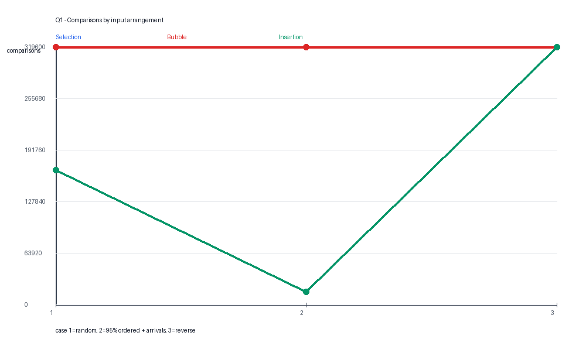

# Q2 Sequential Search

Sequential Search is useful when the temporary list is small, changes continuously, and is searched only occasionally. It needs no ordering or index construction, which can matter when records are inserted and removed often. A successful search at zero-based position k takes k+1 comparisons; an unsuccessful search takes n.

| List size | Case | Returned index | Comparisons |
| --- | --- | --- | --- |
| 10 | first | 0 | 1 |
| 10 | middle | 5 | 6 |
| 10 | last | 9 | 10 |
| 10 | unsuccessful | -1 | 10 |
| 100 | first | 0 | 1 |
| 100 | middle | 50 | 51 |
| 100 | last | 99 | 100 |
| 100 | unsuccessful | -1 | 100 |
| 1000 | first | 0 | 1 |
| 1000 | middle | 500 | 501 |
| 1000 | last | 999 | 1000 |
| 1000 | unsuccessful | -1 | 1000 |
| 10000 | first | 0 | 1 |
| 10000 | middle | 5000 | 5001 |
| 10000 | last | 9999 | 10000 |
| 10000 | unsuccessful | -1 | 10000 |

The experiments match the position-based prediction: first-position hits take one comparison, middle hits take about n/2, and last-position or unsuccessful searches take n. For the changed condition, assume 20 facilities have 1,000 active records each (20,000 total), 50,000 requests arrive per hour, 90 percent are successful at uniformly distributed positions, and 10 percent miss. Expected comparisons are approximately 11,000.45 per request, or about 550,022,500 per hour. These figures describe the stated model, not measured workload data.

Decision: retain Sequential Search for small, low-frequency temporary lists. With 20 facilities and a high request rate, use a hash index keyed by tool ID or a database index, and update it as tools are issued and returned. The data changes do not remove the need to meet lookup latency.

# Q3 Brute-Force String Matching

The implementation tries each possible text alignment and stops an alignment at its first mismatching character. The fast case uses a short text with a match at the start. The high-work case uses a long run of A characters and a pattern that matches almost all of each window before a final mismatch, with a valid match at the last alignment. The third case checks overlapping occurrences.

| Test | Text length | Pattern length | Match positions | Character comparisons |
| --- | --- | --- | --- | --- |
| early distinct hit | 28 | 9 | [0] | 29 |
| late near-match | 5001 | 50 | [4951] | 247600 |
| overlapping matches | 7 | 3 | [0, 2, 4] | 11 |

The late near-match performs 247,600 character comparisons: 4,951 failed alignments each compare 50 characters, and the final alignment compares all 50 characters and matches. The overlapping example returns positions 0, 2, and 4. Text length alone does not predict cost; repeated prefix matches and the location of a mismatch determine how much work each alignment performs.

Worst-case time is O((n-m+1)m), commonly written O(nm), where n is text length and m is pattern length. Extra working space is O(1), excluding the returned list of match positions.

# Q4 Brute-Force Closest Pair

The program visits each unordered pair once by setting j greater than i. It compares squared distances and takes one square root after finding the minimum. Thus it performs exactly n(n-1)/2 distance calculations and uses constant auxiliary space.

| Points n | Distance calculations | Minimum distance | Seconds |
| --- | --- | --- | --- |
| 100 | 4950 | 12761.296 | 0.000977 |
| 300 | 44850 | 12761.296 | 0.010604 |
| 600 | 179700 | 12761.296 | 0.033902 |
| 1000 | 499500 | 12761.296 | 0.085193 |
| 2000 | 1999000 | 12761.296 | 0.452285 |

At 2,000 points the measured scan makes 1,999,000 distance calculations and takes 0.452 seconds. Using a one-second response target and quadratic scaling from this run gives an estimated limit near 2,974 points. This is a rough extrapolation from one computer and one point distribution, not a hard capacity guarantee. The source of the inefficiency is examining every possible pair, even when most pairs are far apart.

# Q5 Brute-Force Convex Hull

For each candidate line through two points, the program checks the sign of the cross product for the other points. If both positive and negative signs occur, points lie on both sides and the pair cannot be a supporting boundary edge. If all points lie on one side or on the line, the segment is accepted only when no collinear point lies outside it. The accepted edges form a graph that is walked to list the boundary vertices.

| Points | Candidate pairs | Orientation tests | Hull vertices |
| --- | --- | --- | --- |
| 12 | 66 | 384 | 12 |
| 24 | 276 | 2782 | 24 |
| 48 | 1128 | 20538 | 48 |
| 72 | 2556 | 67094 | 72 |
| 96 | 4560 | 156274 | 96 |

The two designed examples include interior points, duplicate coordinates, and collinear boundary points; a fully collinear set is also tested. The independent randomized test compares the returned hull vertices with a monotone-chain reference on 60 point sets. A supporting line proves that the point set is contained in one closed half-plane, so the accepted extreme segment lies on the convex boundary. The collinear segment check is needed to avoid accepting a shorter segment when another point extends beyond it.

There are n(n-1)/2 candidate pairs. In the worst case, each pair may inspect n-2 other points, giving O(n^3) time. Early rejection makes the measured orientation count data-dependent. Space is O(n+h), where h is the number of hull vertices and graph edges. Floating-point coordinates close to collinear can create numerical sensitivity; production geometry should use scaled integers or a robust orientation predicate.

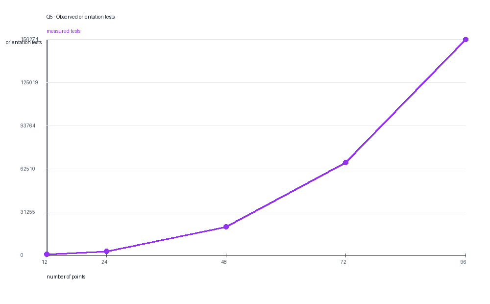

# Q6 Exhaustive Search

Each bit mask represents one package subset. The program evaluates the total weight and humanitarian value for all 2^n masks, keeps only subsets that satisfy the payload limit, and retains the feasible subset with the largest value.

For the independently checkable four-package example with capacity 15, packages A and B weigh 10 and 5 and deliver values 60 and 40. The program returns A+B with total weight 15 and value 100. The alternative C+D+B has the same weight and value 90, so the returned result is the verified optimum.

| Packages n | Candidate subsets | Item checks | Best weight | Best value | Seconds |
| --- | --- | --- | --- | --- | --- |
| 8 | 256 | 2048 | 25 | 155 | 0.0004 |
| 12 | 4096 | 49152 | 48 | 244 | 0.0097 |
| 16 | 65536 | 1048576 | 65 | 325 | 0.1683 |
| 18 | 262144 | 4718592 | 73 | 384 | 0.5206 |
| 20 | 1048576 | 20971520 | 79 | 442 | 2.5717 |

The candidate count doubles whenever one package is added. The implementation performs n item checks per subset, so its direct loop is O(n2^n) time. At n=20 it evaluates 1,048,576 subsets and 20,971,520 item checks in 2.57 seconds on this run. With a three-second response budget, n=20 is the largest tested size accepted for this environment. The n=21 case would require 44,040,192 item checks and is projected at about 5.40 seconds from the measured item-check rate, so it is outside that budget. This projection is not a separate timing measurement.

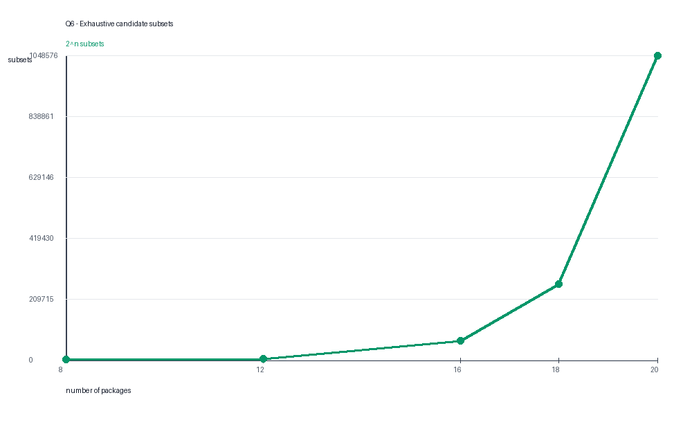

# Q7 Day-4 Design Challenge

## A Diagnose the bottleneck

The Q4 implementation repeats a distance calculation for every unordered pair. The count grows as n(n-1)/2: it rises from 4,950 at 100 points to 1,999,000 at 2,000 points. Most of the work is comparing pairs that cannot be closest.

## B State the design objective

Keep the same closest-pair answer on the same points while reducing distance calculations. The comparison uses identical deterministic point sets and treats distance calculations as the primary measure.

## C Revised design

The redesigned program sorts points by x and y once, divides the x-ordered list into halves, recursively finds the closest pair in each half, and checks a narrow strip around the split. Because the strip remains ordered by y, comparisons stop as soon as vertical separation is at least the best known distance. Duplicate coordinates are detected before recursion and return distance zero.

The recurrence is T(n)=2T(n/2)+O(n): the two recursive halves contribute 2T(n/2), while partitioning and strip scanning contribute linear work per level. The solution is O(n log n) time with O(n) auxiliary space. Sorting has an upfront cost and the implementation uses additional lists and sets.

## D Prediction before the final comparison run

The saved prediction expected equal minimum distances, an exact n(n-1)/2 count for brute force, and increasing distance-count reductions from divide-and-conquer as n grows. The prediction file was saved before regenerating the final comparison CSV; earlier exploratory runs were used to debug the implementation.

| n | Brute distances | D&C distances | Reduction | Same distance | Brute seconds | D&C seconds |
| --- | --- | --- | --- | --- | --- | --- |
| 100 | 4950 | 196 | 96.04% | Yes | 0.000977 | 0.000418 |
| 300 | 44850 | 704 | 98.43% | Yes | 0.010604 | 0.001853 |
| 600 | 179700 | 1571 | 99.13% | Yes | 0.033902 | 0.002794 |
| 1000 | 499500 | 2915 | 99.42% | Yes | 0.085193 | 0.005226 |
| 2000 | 1999000 | 6607 | 99.67% | Yes | 0.452285 | 0.011743 |

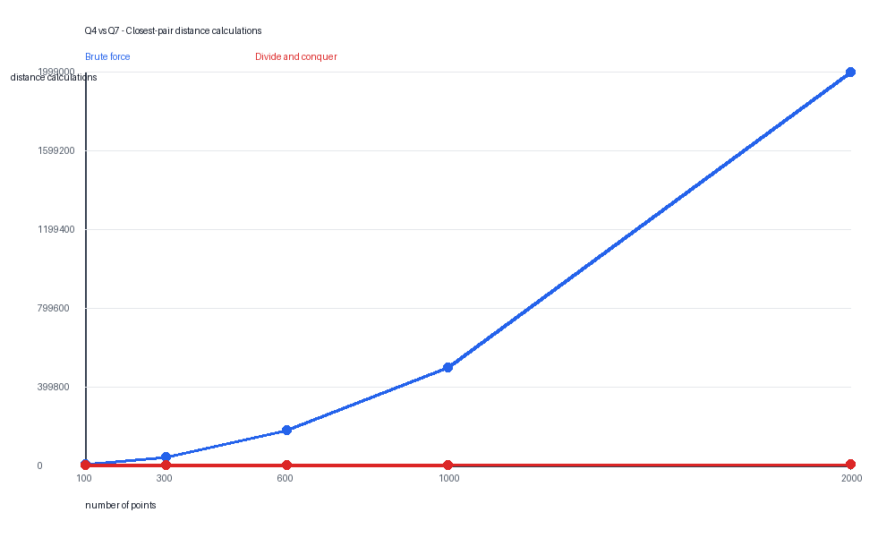

## E Validate the redesign

All five listed point-set sizes return the same minimum distance. At n=2,000 the redesign makes 6,607 distance calculations instead of 1,999,000, a 99.67 percent reduction. It also lowers the measured runtime from about 0.452 seconds to about 0.012 seconds on this machine. The test harness compares the redesign with the brute-force baseline for 40 random point sets and checks duplicate coordinates.

## F Defend the design

The operation-count prediction was supported for these datasets. The redesign adds sorting, recursion, temporary lists, and more code, so brute force remains a clear choice for very small inputs and as a simple correctness reference. The reported timing advantage is environment-specific; the distance-count reduction is the stronger evidence.

# Complexity Summary

| Question | Best time | Average / expected | Worst time | Extra space |
| --- | --- | --- | --- | --- |
| Q1 Selection | Theta(n^2) | Theta(n^2) | Theta(n^2) | O(1) |
| Q1 Bubble (early exit) | Theta(n) | Theta(n^2) | Theta(n^2) | O(1) |
| Q1 Insertion | Theta(n) | Theta(n^2) | Theta(n^2) | O(1) |
| Q2 Sequential Search | Theta(1) | Theta(n) | Theta(n) | O(1) |
| Q3 Brute String Match | O(n) for easy mismatches | Data dependent | O(nm) | O(1) + output |
| Q4 Brute Closest Pair | Theta(n^2) | Theta(n^2) | Theta(n^2) | O(1) |
| Q5 Brute Hull | Data dependent | Data dependent | O(n^3) | O(n+h) |
| Q6 Exhaustive Knapsack | Theta(n 2^n) | Theta(n 2^n) | Theta(n 2^n) | O(n) output |
| Q7 Closest Pair D&C | Theta(n log n) | Theta(n log n) | Theta(n log n) | O(n) |

# Conclusion

Among the required sorting methods, Insertion Sort best fits a small arrival batch on a mostly ordered list. Sequential Search is defensible only for small or infrequently searched lists. Brute-force string matching is simple but sensitive to repeated prefix matches. The convex-hull and exhaustive-search implementations make their geometric and combinatorial work visible, but their cubic and exponential growth limit scale. The closest-pair comparison demonstrates a measured reason to redesign an all-pairs scan when the input grows.

# Test and Output Evidence

The included test harness ran ten checks successfully: sorting equivalence, sequential-search positions and misses, string overlaps and edge cases, closest-pair baseline, convex-hull examples and randomized reference comparison, the knapsack optimum, randomized closest-pair equivalence, duplicate-coordinate handling, and empty/single-point closest-pair inputs.

## Execution evidence

The seven output images below are rendered from the saved actual program transcripts. The corresponding RUN_OUTPUT.txt files are stored beside each image.

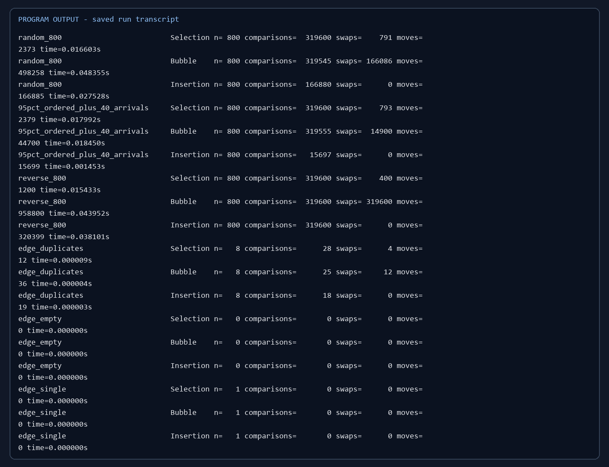

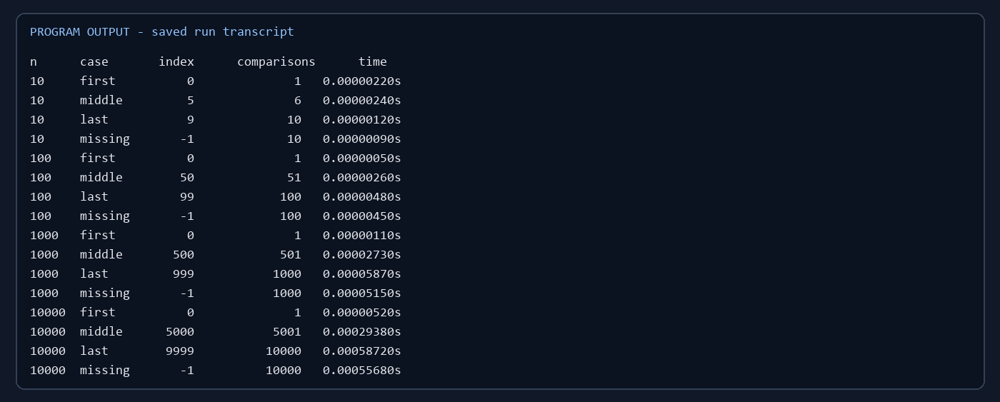

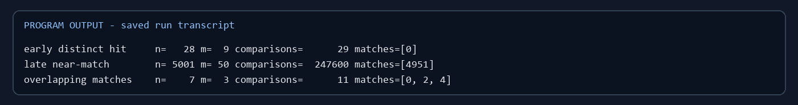

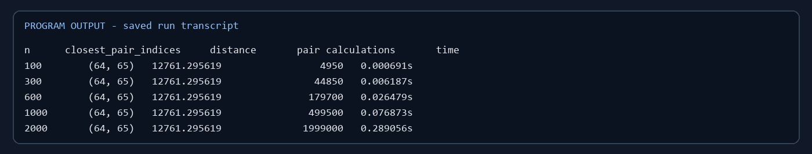

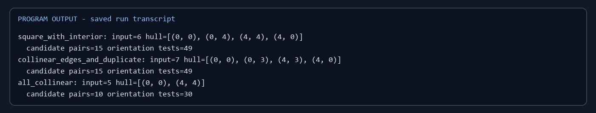

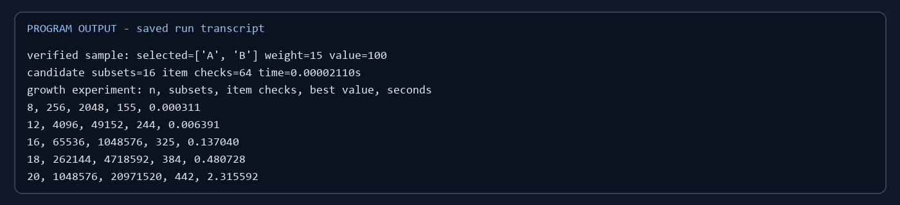

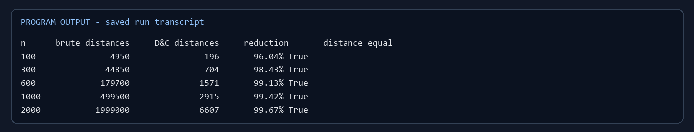
