# CO3 Assignment 3 Divide and Conquer Algorithms

**Course:** CSA06 Design and Analysis of Algorithms  
**Student:** Hitesh C, Register No. 192524005  
**Partner:** [Add partner name and register number]  
**Assignment mode:** Pair work  
**Question set:** Q1-Q7

## Executive summary

This report presents implementations and measured comparisons for seven divide-and-conquer investigations: max/min and binary search; Merge Sort and Quick Sort; Karatsuba multiplication; Strassen multiplication; closest pair; Median of Medians and Meet-in-the-Middle; and a maximum-subarray design challenge. Programs were run, their compared outputs were checked, and the test harness passed ten test groups covering 50 deterministic randomized inputs plus edge cases.

Q7 uses maximum-subarray sum as a working example because the supplied question file specifies the design process but not the actual challenge problem. Confirm this choice against the instructor's Day-4 prompt. The partner name, actual per-person contributions, and authentic pre-discussion Q7 proposals are left for both students to complete; the report does not claim that unverified pair-work steps have already happened.

## Method and evidence

Programs use Python 3.10 or later. The experiment generator uses fixed seed 192524005. Counts are instrumented algorithm operations; timing values are medians of three runs except where the table explicitly records one run. Timing values depend on runtime and machine. CSV files preserve raw results. Output images are rendered from each program's saved stdout log, not captured from a live terminal window.

The selected input sizes are stated in the experiment tables because the question file does not provide numeric size ranges. Correctness was checked against independent/reference implementations, including randomized tests for sorting, multiplication, matrix products, closest pair, selection, subset sum, and maximum subarray.

## Q1 Max Min and Binary Search

The max/min function uses a tournament-style divide-and-conquer recurrence. A one-item range returns the item twice; a two-item range needs one comparison. Larger ranges are split, solved recursively, and combined with one comparison for the minima and one for the maxima. The comparison counts match the power-of-two formula 3n/2 - 2 and improve on two independent scans, which use 2n - 2 comparisons.

Binary Search is iterative over an ascending array. At each midpoint it tests equality and, if needed, whether the midpoint is below the target. The sorted-order invariant proves that the opposite half cannot contain the target. Its recurrence is T(n)=T(n/2)+O(1)=O(log n), with O(1) extra space.

| n | D&C comparisons | Two scans | D&C formula |
|---|---|---|---|
| 8 | 10 | 14 | 10 |
| 16 | 22 | 30 | 22 |
| 32 | 46 | 62 | 46 |
| 64 | 94 | 126 | 94 |
| 128 | 190 | 254 | 190 |
| 256 | 382 | 510 | 382 |
| 512 | 766 | 1022 | 766 |

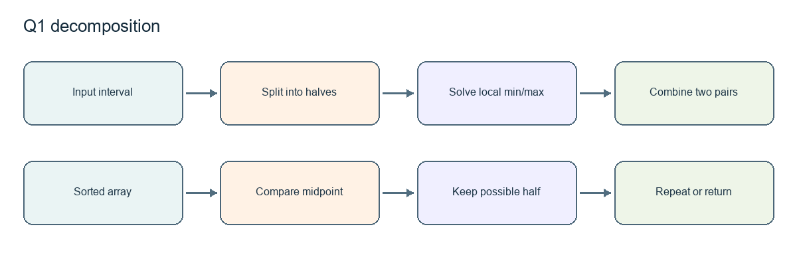

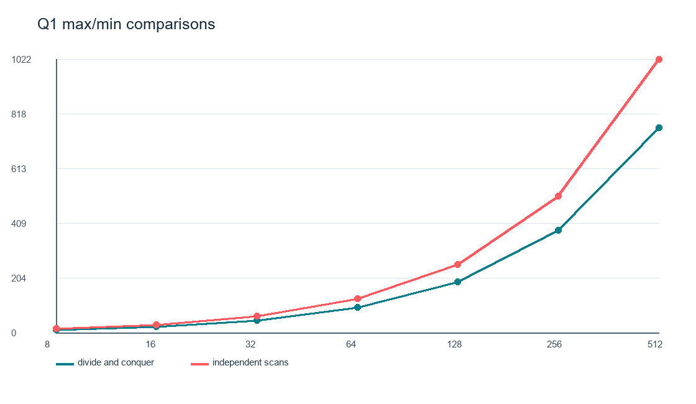

## Q2 Merge Sort and Quick Sort

Merge Sort halves every input range, recursively sorts both halves, then merges in linear time. T(n)=2T(n/2)+Theta(n)=Theta(n log n), with Theta(n) auxiliary storage. Quick Sort uses the last element as the Lomuto pivot. The balanced case is an engineered distinct-key permutation that produces nearly equal partitions; the unbalanced case is ascending distinct data, for which each pivot leaves n-1 keys on one side.

The measured recursion depths show the effect of decomposition directly. At n=511, balanced Quick Sort reaches depth 9; ascending input reaches depth 511 and takes 130,305 comparisons. Merge Sort remains at depth 10 and uses 2,295 comparisons on the ascending input. Quick Sort has average Theta(n log n) time but worst-case Theta(n^2); Merge Sort has predictable Theta(n log n) time. For unknown input, a randomized or introspective pivot strategy is safer unless stability or predictable worst-case performance makes Merge Sort preferable.

| Case | n | Quick comps | Quick depth | Merge comps | Merge depth |
|---|---|---|---|---|---|
| balanced_last_pivot | 31 | 98 | 5 | 88 | 6 |
| ascending_last_pivot | 31 | 465 | 31 | 75 | 6 |
| balanced_last_pivot | 63 | 258 | 6 | 224 | 7 |
| ascending_last_pivot | 63 | 1953 | 63 | 186 | 7 |
| balanced_last_pivot | 127 | 642 | 7 | 544 | 8 |
| ascending_last_pivot | 127 | 8001 | 127 | 441 | 8 |
| balanced_last_pivot | 255 | 1538 | 8 | 1280 | 9 |
| ascending_last_pivot | 255 | 32385 | 255 | 1016 | 9 |
| balanced_last_pivot | 511 | 3586 | 9 | 2944 | 10 |
| ascending_last_pivot | 511 | 130305 | 511 | 2295 | 10 |

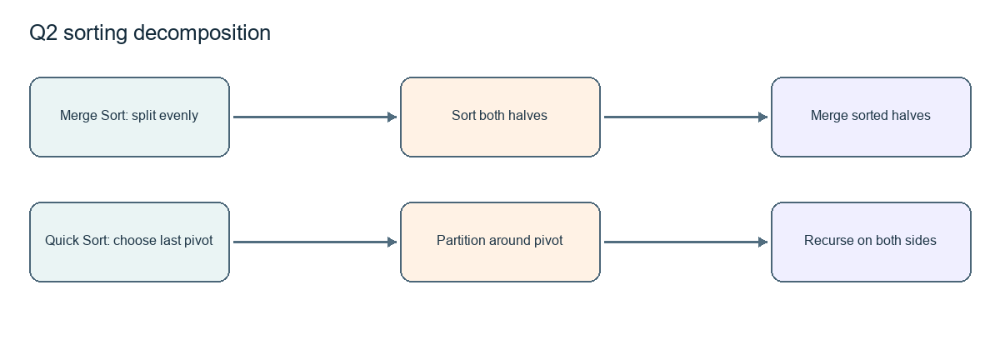

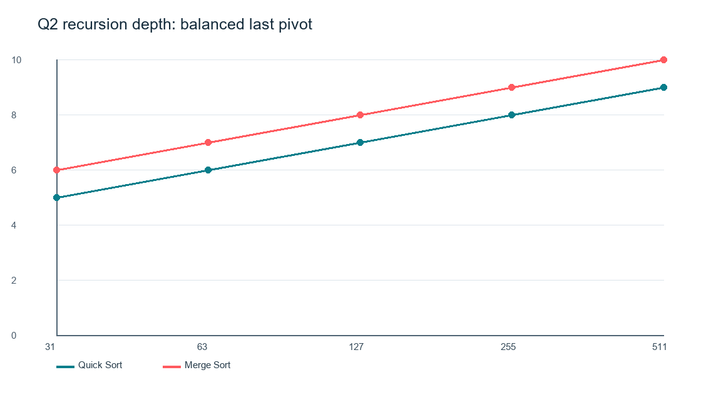

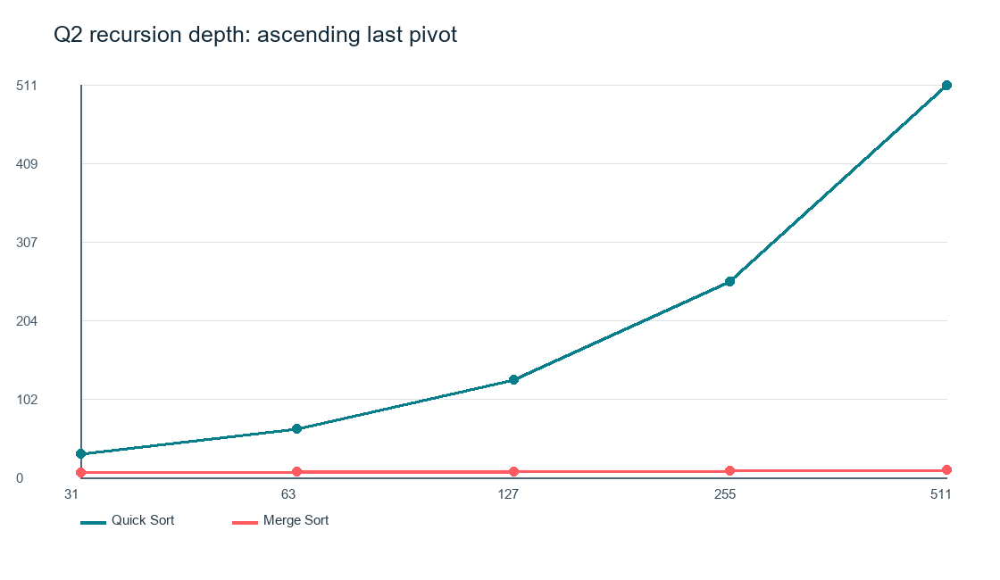

## Q3 Karatsuba Multiplication

The decimal operands are split at a common power-of-ten boundary: x=x1*10^m+x0 and y=y1*10^m+y0. The algorithm computes z0=x0*y0, z2=x1*y1, and z1=(x0+x1)(y0+y1)-z0-z2, then recombines the shifted terms. This replaces four recursive products with three. T(n)=3T(n/2)+Theta(n)=Theta(n^(log2 3)), approximately Theta(n^1.585), compared with Theta(n^2) schoolbook digit products.

With a 24-digit base-case threshold, Karatsuba uses fewer base digit products at 32 digits and above. In the measured timings, schoolbook remains faster through 96 digits; Karatsuba first becomes faster at 128 digits and stays faster in the 192- and 256-digit samples. This run places the observed crossover between 96 and 128 digits for this implementation and runtime, not at a universal threshold. Integer conversion, recursion, and additions explain why fewer products do not guarantee a speedup for small inputs.

| Digits | Schoolbook products | Karatsuba products | Schoolbook s | Karatsuba s |
|---|---|---|---|---|
| 8 | 64 | 64 | 0.00001300 | 0.00001640 |
| 16 | 256 | 256 | 0.00003030 | 0.00004100 |
| 24 | 576 | 576 | 0.00005390 | 0.00007900 |
| 32 | 1024 | 801 | 0.00009300 | 0.00012520 |
| 48 | 2304 | 1609 | 0.00019270 | 0.00024610 |
| 64 | 4096 | 2273 | 0.00032490 | 0.00036510 |
| 96 | 9216 | 4731 | 0.00071610 | 0.00074560 |
| 128 | 16384 | 7141 | 0.00124240 | 0.00113770 |
| 192 | 36864 | 14615 | 0.00287930 | 0.00222040 |
| 256 | 65536 | 21510 | 0.00510890 | 0.00343080 |

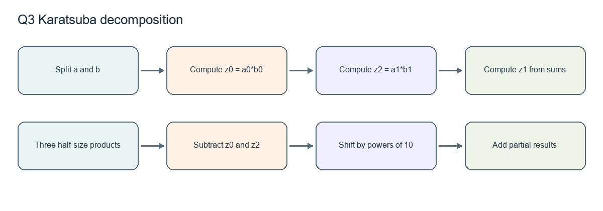

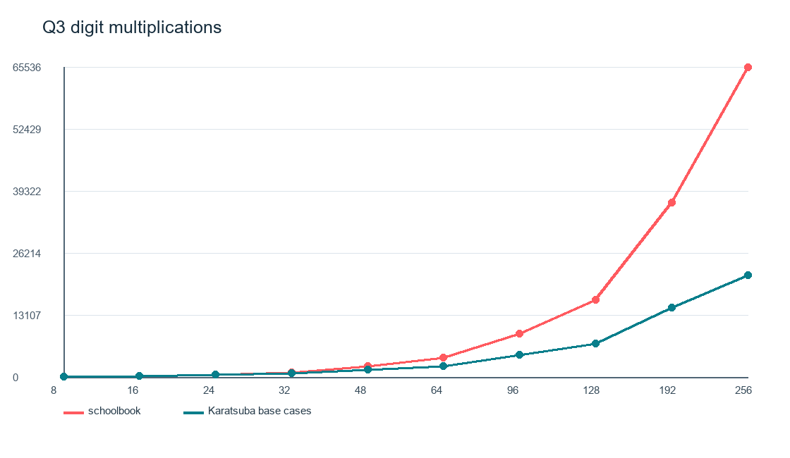

## Q4 Strassen Matrix Multiplication

Conventional block multiplication forms eight half-size products. Strassen's identities reduce this to seven products M1 through M7, followed by block additions and subtractions. T(n)=7T(n/2)+Theta(n^2)=Theta(n^(log2 7)), approximately Theta(n^2.807), compared with conventional Theta(n^3). Non-power-of-two square matrices are zero-padded to the next power of two and cropped after multiplication; the implementation switches to conventional multiplication at a 16 by 16 cutoff.

The operation counts favor Strassen from n=32 onward, but the wall-clock advantage starts only at larger sizes. In this run, conventional multiplication is slightly faster at n=32, while Strassen is faster at n=64 and n=128; the single n=256 run also favors Strassen. This places the observed crossover between 32 and 64 for this implementation, but the n=256 timing is not repeated and the threshold is not universal. Matrix additions, temporary allocations, cache behavior, and the small number of sizes limit the timing conclusion. Conventional multiplication remains a sensible choice for small or memory-constrained matrices.

| n | Classical mults | Strassen mults | Strassen add/sub | Classical s | Strassen s |
|---|---|---|---|---|---|
| 8 | 512 | 512 | 448 | 0.00017470 | 0.00018790 |
| 16 | 4096 | 4096 | 3840 | 0.00076350 | 0.00077190 |
| 32 | 32768 | 28672 | 32512 | 0.00576680 | 0.00633660 |
| 64 | 262144 | 200704 | 250112 | 0.05842990 | 0.04968850 |
| 128 | 2097152 | 1404928 | 1840896 | 0.45067420 | 0.34898120 |
| 256 | 16777216 | 9834496 | 13246720 | 3.32468800 | 2.61539320 |

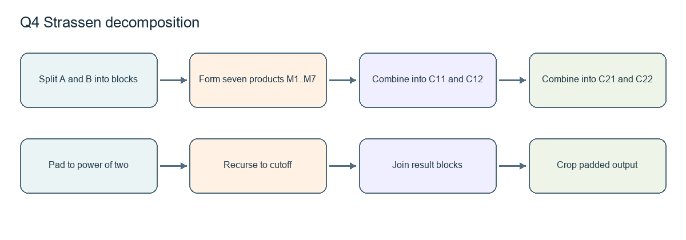

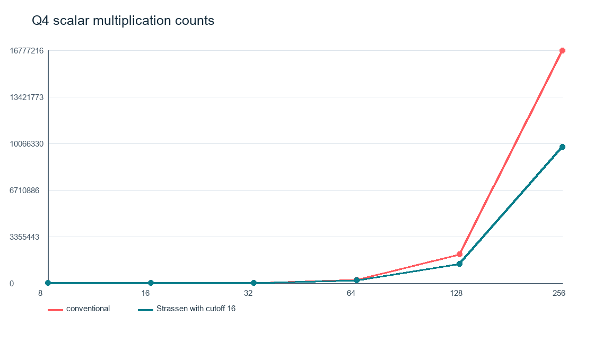

## Q5 Closest Pair of Points

The divide-and-conquer implementation sorts points by x and y, splits at the x-median, recursively solves both halves, and scans a y-ordered strip around the dividing line. With the current best distance as a bound, each strip point needs to be checked against at most the next seven points. Sorting and linear combine work at each level give T(n)=2T(n/2)+O(n)=O(n log n), while brute force checks n(n-1)/2 pairs in O(n^2) time.

Both methods returned the same distance on every measured point set. At n=20, brute force is slightly faster despite doing 190 distance calculations versus 23 for the recursive method. From n=100, divide and conquer is faster in the observed runs; at n=1,600 it performs 2,174 distance calculations versus 1,279,200 for brute force. The Python reference uses copied slices and identity sets, so its actual temporary storage can reach O(n log n); a buffer-reuse implementation can reduce auxiliary storage to O(n).

| n | Brute distances | D&C distances | Brute s | D&C s |
|---|---|---|---|---|
| 20 | 190 | 23 | 0.00003590 | 0.00004430 |
| 100 | 4950 | 128 | 0.00088690 | 0.00026990 |
| 300 | 44850 | 366 | 0.01140830 | 0.00107530 |
| 600 | 179700 | 720 | 0.03451690 | 0.00244560 |
| 1000 | 499500 | 1137 | 0.09534880 | 0.00502640 |
| 1600 | 1279200 | 2174 | 0.24613090 | 0.00745090 |

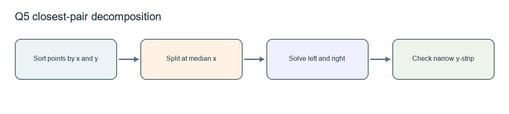

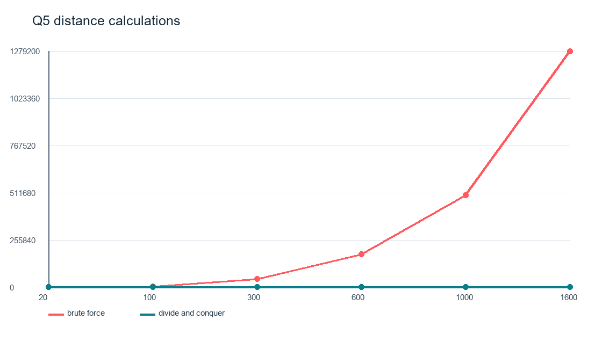

## Q6 Median of Medians and Meet in the Middle

Median of Medians groups values in fives, finds each group median, recursively selects the median of those medians, and partitions into less/equal/greater groups. The pivot guarantees constant-fraction elimination. T(n)<=T(n/5)+T(7n/10+O(1))+O(n), so worst-case time is O(n), with O(n) storage in this list-based version. Randomized QuickSelect is expected O(n) but worst-case O(n^2); first-pivot QuickSelect on ascending input demonstrates the poor-partition case. Randomization reduces the likelihood of bad pivots but cannot remove the worst-case bound.

Meet-in-the-Middle splits a subset-sum input, enumerates each half, sorts one side's sums, and searches for a complement on the other side. Its time is O(n*2^(n/2)) and space is O(2^(n/2)), versus O(n*2^n) time for full enumeration. The no-solution experiments verify full enumeration through n=22; larger exhaustive counts in the table are theoretical counts, not executed timings. At n=34 the method stores 131,072 partial sums per half and completes in about 0.406 s in this run.

| n | MoM comps | Random QS comps | First-pivot comps | MoM s | Random QS s |
|---|---|---|---|---|---|
| 101 | 726 | 487 | 7752 | 0.00010570 | 0.00006090 |
| 501 | 4549 | 3436 | 188752 | 0.00075570 | 0.00032200 |
| 1001 | 8259 | 6976 | 752502 | 0.00133050 | 0.00060070 |
| 2001 | 18727 | 15017 | 3005002 | 0.00398460 | 0.00253210 |
| 3001 | 28575 | 9154 | 6757502 | 0.00361440 | 0.00073560 |

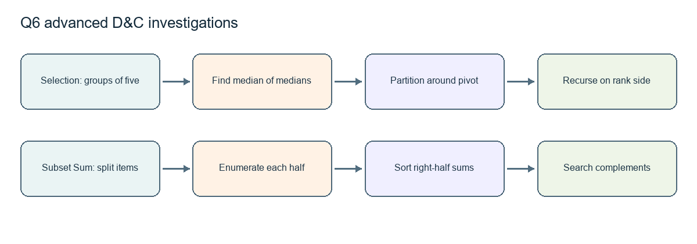

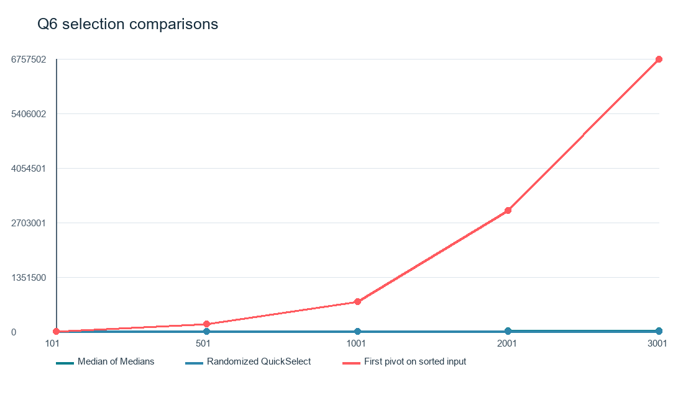

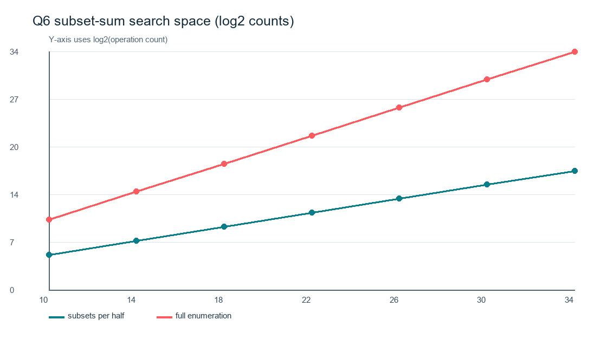

## Q7 Day 4 Design Challenge: Maximum Subarray

The supplied assignment describes the Day-4 design stages but does not identify the challenge problem. This submission uses maximum contiguous subarray sum as a stated working example. The input is a non-empty integer array. A recursive call returns the best sum and its indices. The best interval is either in the left half, in the right half, or crosses the midpoint; the crossing candidate is built from the best left suffix and right prefix.

The combine scan is linear, so T(n)=2T(n/2)+Theta(n)=Theta(n log n), using Theta(log n) recursion space. The brute-force reference checks all n(n+1)/2 segments in Theta(n^2) time. The outputs matched on the demonstration input and randomized harness inputs. For the selected sample, D&C uses 29 boundary sum updates versus 45 brute-force updates; at n=4,096 the experiment uses 49,152 versus 8,390,656 updates. If the class supplied a different Day-4 problem, replace this section and implementation before submission.

| n | D&C updates | Brute updates | D&C s | Brute s |
|---|---|---|---|---|
| 16 | 64 | 136 | 0.00002700 | 0.00002240 |
| 64 | 384 | 2080 | 0.00011740 | 0.00034560 |
| 256 | 2048 | 32896 | 0.00050870 | 0.00499670 |
| 1024 | 10240 | 524800 | 0.00236430 | 0.08787960 |
| 2048 | 22528 | 2098176 | 0.00471650 | 0.33748590 |
| 4096 | 49152 | 8390656 | 0.00987120 | 1.41088110 |

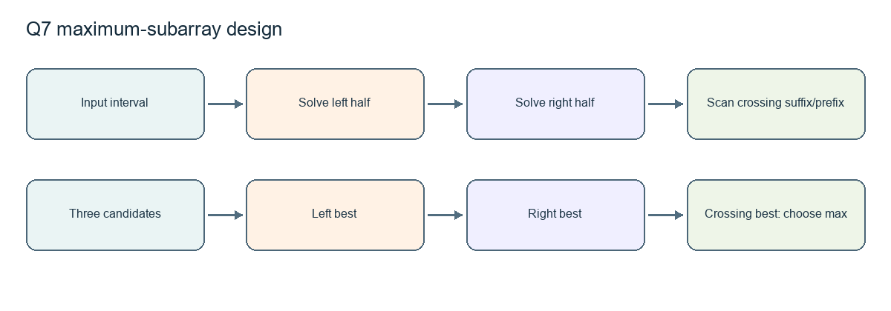

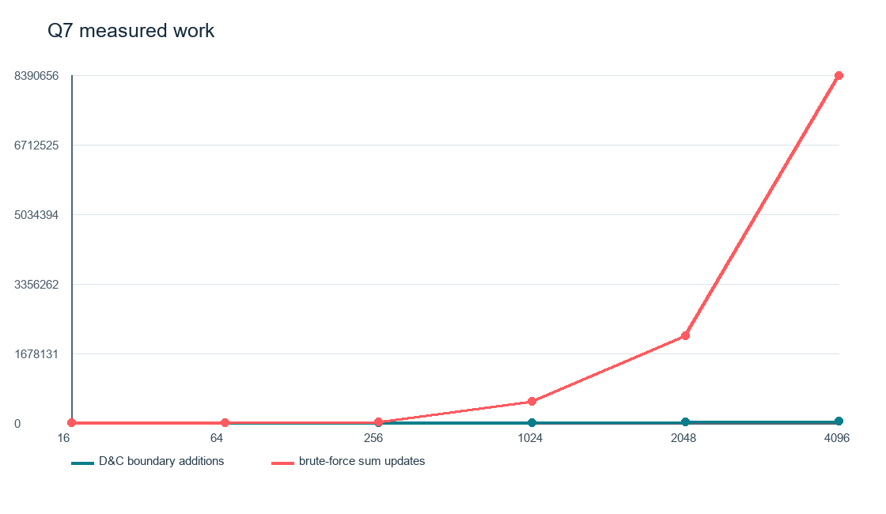

## Complexity summary

| Question | Algorithm | Time | Recurrence / operation note | Space |
|---|---|---|---|---|
| Q1 | Max/min D&C | Theta(n) | 3n/2-2 comparisons for powers of two | Theta(log n) recursion |
| Q1 | Binary Search | Theta(log n) | At most two key comparisons per iteration | Theta(1) iterative |
| Q2 | Merge Sort | Theta(n log n) | All cases | Theta(n) |
| Q2 | Quick Sort | Average Theta(n log n); worst Theta(n^2) | Pivot-dependent | Worst recursion Theta(n) |
| Q3 | Karatsuba | Theta(n^1.585) | 3T(n/2)+Theta(n) | Recursive temporaries |
| Q4 | Strassen | Theta(n^2.807) | 7T(n/2)+Theta(n^2) | Temporary matrices |
| Q5 | Closest pair D&C | Theta(n log n) | 2T(n/2)+O(n) | Reference slices can reach Theta(n log n) |
| Q6 | Median of Medians | Worst-case O(n) | T(n/5)+T(7n/10)+O(n) | O(n) list storage |
| Q6 | Meet-in-the-Middle | O(n*2^(n/2)) | Half-subsets + binary search | O(2^(n/2)) |
| Q7 | Maximum subarray D&C | Theta(n log n) | 2T(n/2)+Theta(n) | Theta(log n) recursion |

## Technical conclusions

- The max/min tournament meets its comparison bound, and binary search benefits from sorted order by discarding half the remaining keys.
- Merge Sort has predictable recursion depth. Last-pivot Quick Sort is highly sensitive to input order; use a guarded pivot strategy when input characteristics are unknown.
- Karatsuba reduced digit products and became faster only beyond the measured small-input range. Select its cutoff empirically.
- Strassen's measured timing crossover was between n=32 and n=64 in this run; the threshold requires broader repeated measurements.
- Divide-and-conquer closest pair reduced distance calculations sharply and was faster from the tested n=100 point set onward.
- Median of Medians provides deterministic worst-case selection; randomized QuickSelect was faster in these samples but does not provide the same worst-case guarantee.
- Meet-in-the-Middle is useful when 2^(n/2) storage is feasible. Its memory requirement is the main limit.
- Divide-and-conquer maximum subarray outperformed the brute-force baseline as n increased, although Kadane's linear algorithm is preferable if only the final answer is needed and the assignment does not require D&C.

## Pair contribution record

The table below reproduces the primary roles prescribed by the assignment. The companion Student Contribution Record document has blank fields for actual work, names, dates, and confirmations. Both students must complete these fields truthfully. The Q7 proposal templates are intentionally blank for each student's independent pre-discussion work.

| Question | Student A primary role | Student B primary role | Joint work |
|---|---|---|---|
| Q1 | Max/min design, derivation; binary-search experiments | Max/min instrumentation; binary-search elimination | Implement/test both parts |
| Q2 | Quick Sort partition experiments | Merge Sort analysis and recursion-tree comparison | Implement and compare both sorts |
| Q3 | Karatsuba derivation and recurrence | Crossover experiment and overhead analysis | Implement both multipliers |
| Q4 | Matrix experiments and engineering analysis | Strassen algebra and correctness | Implement and verify both methods |
| Q5 | Closest-pair decomposition | Equivalent-data comparison and evidence | Implement and test both methods |
| Q6 | Median of Medians; cross-explain Meet-in-the-Middle | Meet-in-the-Middle; cross-explain pivot quality | Verify the complete investigation |
| Q7 | Independent proposal; recurrence and solution | Independent proposal; implementation and tests | Compare proposals, finalize and evaluate design |

## Output evidence

Each question folder contains the program's plain-text output and a matching image capture rendered from that stdout. The report builder includes these images in the appendix. Source code, pseudocode, diagrams, CSV data, and test logs are available beside the report.

## References

- Cormen, Leiserson, Rivest, and Stein, Introduction to Algorithms, 4th edition. Divide-and-conquer, sorting, selection, and matrix multiplication chapters.
- The CO3 Assignment 3 question sheet supplied with this submission.
