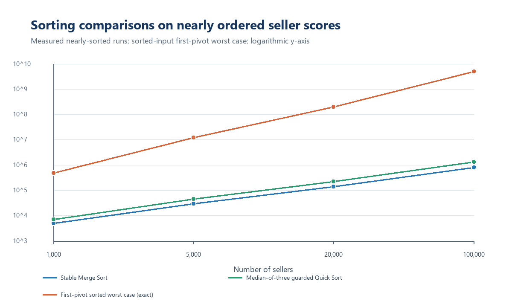
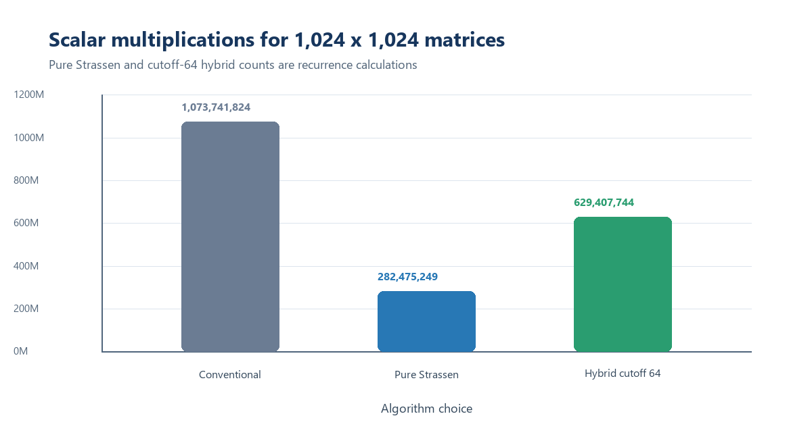
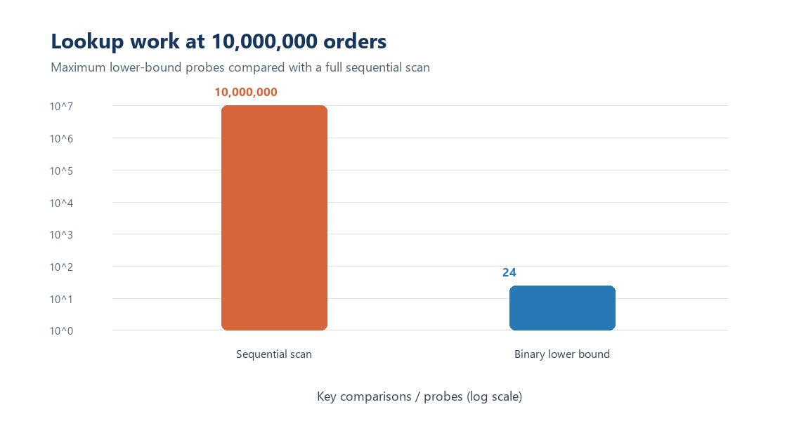
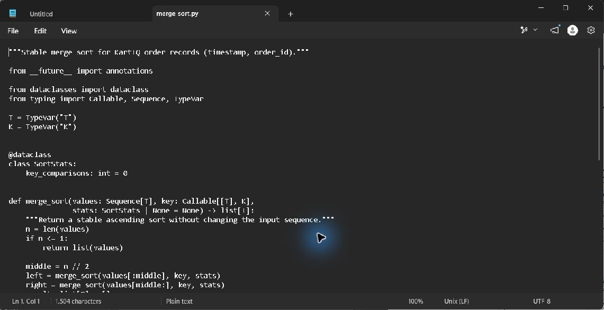
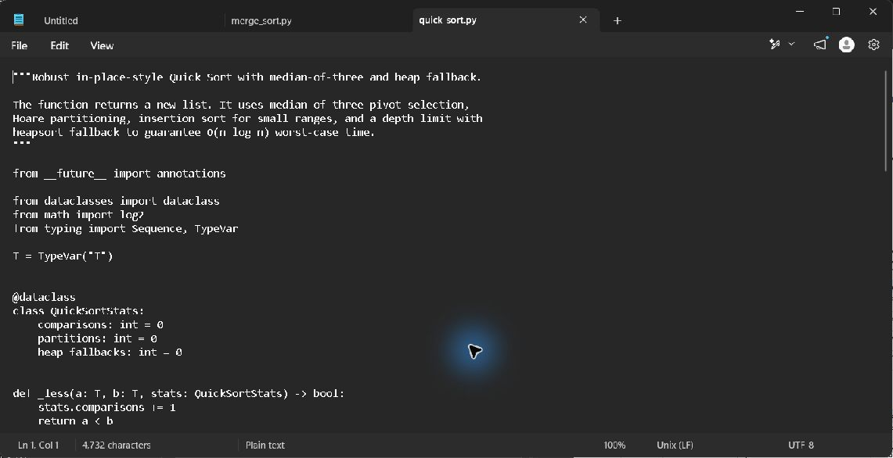
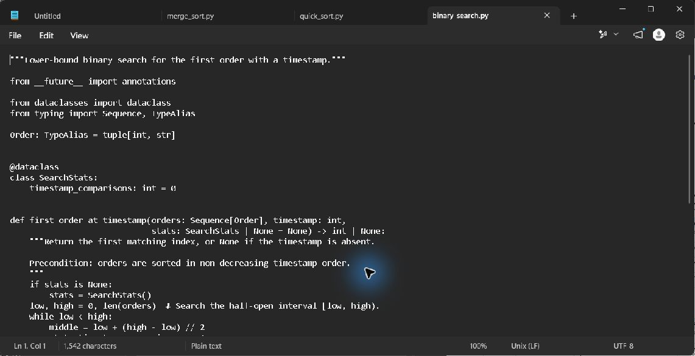
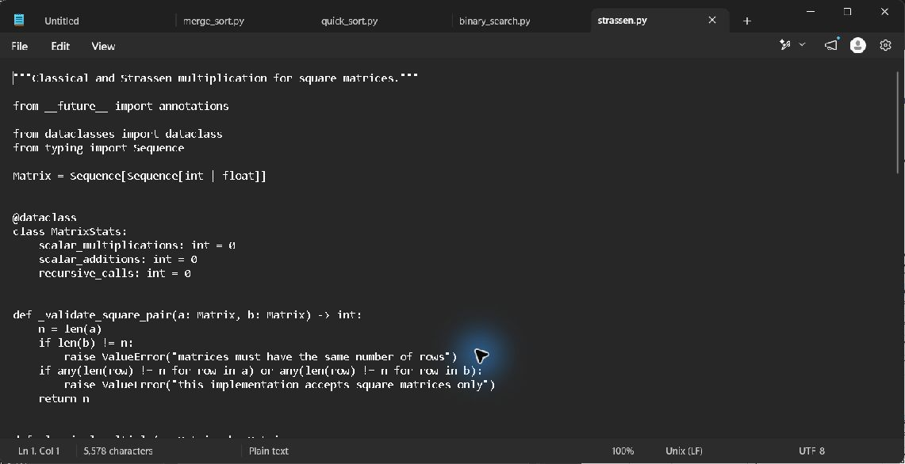
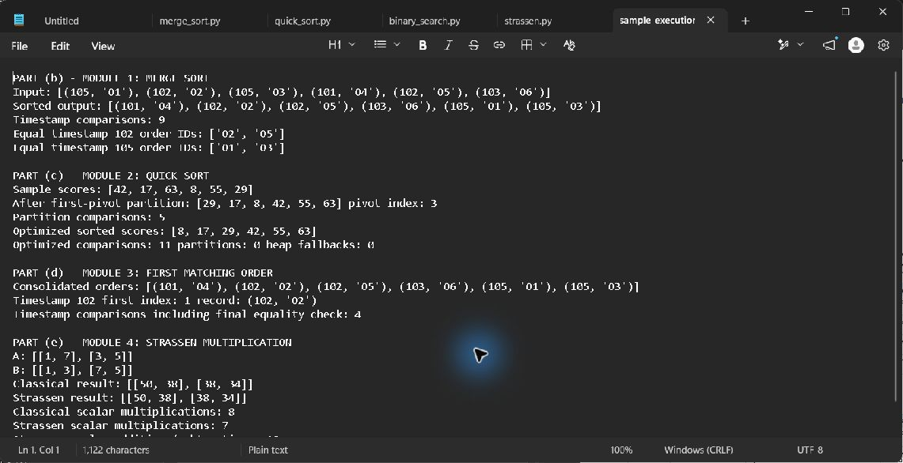
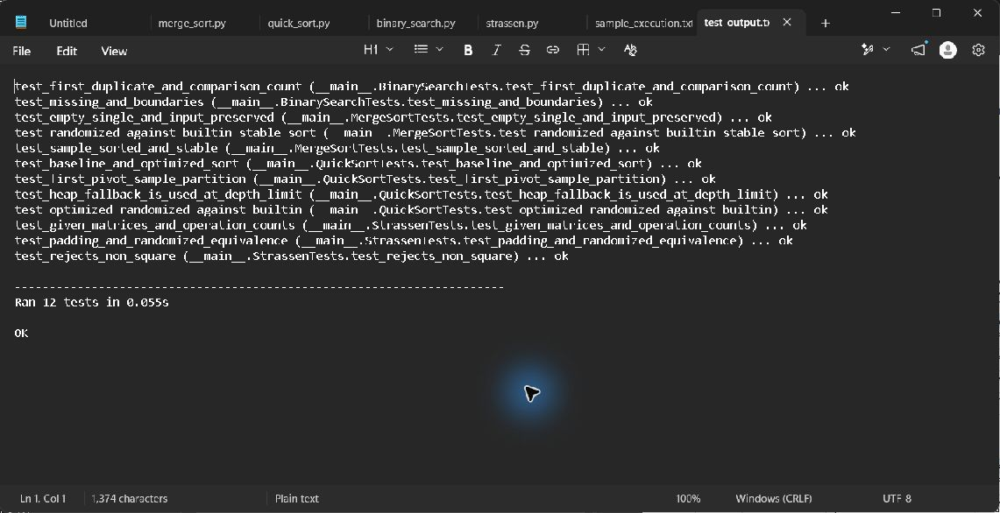
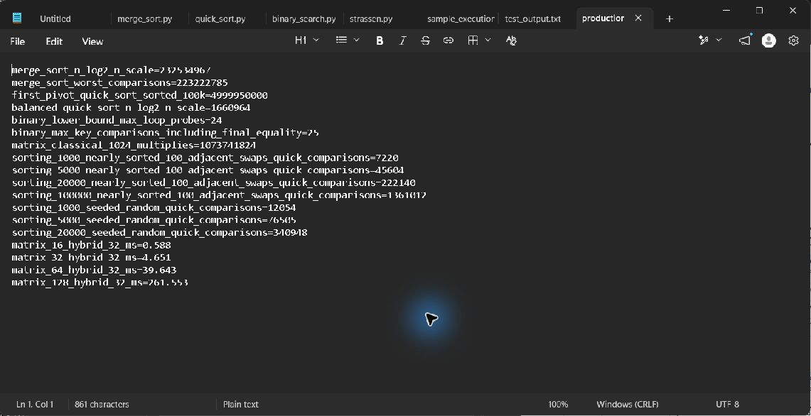

# KartIQ divide-and-conquer case study

**Student:** Hitesh C  
**Register number:** 192524005  
**Course:** CSA06 - Design and Analysis of Algorithms  
**Instructor:** Dr. F. Mary Harin Fernandez  
**Assessment:** CO3 case study, 100 points  
**Due date stated in the question:** 5 October 2027  
**Prepared:** 1 November 2026

## Executive summary

KartIQ's four workloads need different guarantees. Stable Merge Sort preserves the audit order for equal timestamps; guarded Quick Sort replaces the first-element pivot that can take billions of comparisons; lower-bound Binary Search returns the first duplicate timestamp in logarithmic time; and hybrid Strassen multiplication reduces the multiplication count for large dense matrices while retaining conventional multiplication for small blocks. The supplied sample datasets pass the included executable checks. Production calculations use the exact workload sizes stated in the question.

## Part (a): Understand the case

| Module | Requirement | Main issue | Cost of a poor choice | Design used here |
|---|---|---|---|---|
| 1. Order consolidation | Sort 10,000,000 orders by timestamp for audit | Stability for ties; memory footprint | Unstable output changes gateway arrival order; quadratic sorting misses the nightly deadline | Stable Merge Sort; external merge runs if all records do not fit in RAM |
| 2. Seller leaderboard | Re-sort 100,000 scores after small changes | The current first-element pivot degenerates on nearly ordered input | Near-quadratic work freezes sale-time refreshes | Median-of-three Hoare Quick Sort with insertion cutoff and heapsort depth fallback |
| 3. Order lookup | Find an order by timestamp and return the first duplicate | The list must already be sorted; ordinary binary search may return a later duplicate | Linear lookup takes up to 10,000,000 probes; arbitrary duplicate match can confuse support staff | Lower-bound Binary Search over Module 1 output |
| 4. Recommendation scores | Compute `C = A x B` for 1,024 by 1,024 matrices | Multiplication count, temporary memory, additions, numeric behavior | Classical cubic multiplication may be costly; pure Strassen can lose to allocation and addition overhead | Strassen with a measured conventional base-case cutoff; compare classical multiplication as a fallback |

The workload numbers and the four sample inputs below are those in the question. The larger seller input used for a reproducible experiment is synthetic because no production seller file was supplied.

## Part (b): Module 1 - Merge Sort for nightly order consolidation

### Divide, conquer, combine

Merge Sort divides the input into two contiguous halves, recursively sorts each half, then merges the sorted halves by taking the smaller timestamp. On equal timestamps the merge takes the left-half record first. Since the left half contains earlier arrivals, that tie rule preserves gateway arrival order at every level.

### Trace on the supplied orders

Input: `(105,O1), (102,O2), (105,O3), (101,O4), (102,O5), (103,O6)`.

| Merge step | Left input | Right input | Combined result |
|---|---|---|---|
| 1 | `(102,O2)` | `(105,O3)` | `(102,O2), (105,O3)` |
| 2 | `(105,O1)` | `(102,O2), (105,O3)` | `(102,O2), (105,O1), (105,O3)` |
| 3 | `(102,O5)` | `(103,O6)` | `(102,O5), (103,O6)` |
| 4 | `(101,O4)` | `(102,O5), (103,O6)` | `(101,O4), (102,O5), (103,O6)` |
| 5 | `(102,O2), (105,O1), (105,O3)` | `(101,O4), (102,O5), (103,O6)` | `(101,O4), (102,O2), (102,O5), (103,O6), (105,O1), (105,O3)` |

At the final merge, `O2` is taken before `O5` when timestamp 102 ties; `O1` remains before `O3` when timestamp 105 ties. The program reports the same sorted list and nine timestamp comparisons for this six-order example.

### Recurrence, comparison estimate, and memory

For `n > 1`, the worst-case comparison recurrence is `C(n) = C(floor(n/2)) + C(ceil(n/2)) + n - 1`, with `C(1)=0`. It solves to `Theta(n log n)` comparisons and `Theta(n log n)` time in best, average, and worst cases. For 10,000,000 orders, `n log2(n)` is approximately 232,534,967 comparisons as an asymptotic scale estimate. The balanced-split worst-case comparison count is `n ceil(log2 n) - 2^ceil(log2 n) + 1 = 223,222,785`.

The implementation uses `O(n)` merge storage plus `O(log n)` recursion depth. If the orders do not fit in RAM, sort sequential chunks into stable disk runs and merge them in multiple passes. Store each original arrival position and compare `(timestamp, arrival_index)` so stability is preserved across run boundaries.

Pseudocode: [`merge_sort.md`](../Module_1_Merge_Sort/Pseudocode/merge_sort.md). Implementation: [`merge_sort.py`](../Module_1_Merge_Sort/Source_Code/merge_sort.py). Module note: [`module_report.md`](../Module_1_Merge_Sort/Report/module_report.md).

## Part (c): Module 2 - Quick Sort for the live leaderboard

### First-pivot partition trace

The baseline uses Lomuto partitioning with the first value as the pivot. On `[42,17,63,8,55,29]`, pivot 42 is compared with the other five values:

| Scan value | Action | List after action |
|---:|---|---|
| 17 | Below pivot; advances the left boundary | `[42,17,63,8,55,29]` |
| 63 | Not below pivot | `[42,17,63,8,55,29]` |
| 8 | Below pivot; swap into the next left position | `[42,17,8,63,55,29]` |
| 55 | Not below pivot | `[42,17,8,63,55,29]` |
| 29 | Below pivot; swap into the next left position | `[42,17,8,29,55,63]` |
| Pivot placement | Swap 42 with the boundary item | `[29,17,8,42,55,63]` |

The pivot ends at index 3 after five comparisons. The full sorted result is `[8,17,29,42,55,63]`.

### Recurrences and workload comparison

With balanced partitions, `T(n)=2T(n/2)+(n-1)=Theta(n log n)`. With a pivot that repeatedly leaves one empty side, `T(n)=T(n-1)+(n-1)=Theta(n^2)`; for an already ascending list the exact first-pivot count is `n(n-1)/2`. At 100,000 sellers that is 4,999,950,000 comparisons.

The reproducible synthetic near-sorted dataset starts in ascending order and applies 100 evenly spaced adjacent swaps. The first-pivot baseline made 12,247,600 comparisons at `n=5,000`, which is 98.0% of the exact sorted-input count of 12,497,500. Applying that measured ratio to the 100,000-seller sorted-input count gives an estimate of about 4.90 billion comparisons; this is an extrapolation, not a measured 100,000-item baseline. The guarded implementation actually ran on the 100,000-item dataset and made 1,361,012 key comparisons, with the same sorted result.

The production implementation uses median-of-three pivot selection and Hoare partitioning. Insertion Sort handles short ranges. A depth limit switches to Heapsort if partitions become too uneven, preserving an `O(n log n)` worst-case time guarantee. It uses `O(log n)` internal stack space; the public function returns a copy, so total extra storage is `O(n)`. The baseline is included to reproduce the poor pivot behavior; do not use it for a large ordered leaderboard.

Pseudocode: [`quick_sort.md`](../Module_2_Quick_Sort/Pseudocode/quick_sort.md). Baseline and optimized implementations: [`quick_sort_baseline.py`](../Module_2_Quick_Sort/Source_Code/quick_sort_baseline.py), [`quick_sort.py`](../Module_2_Quick_Sort/Source_Code/quick_sort.py). Module note: [`module_report.md`](../Module_2_Quick_Sort/Report/module_report.md).

## Part (d): Module 3 - Binary Search for order lookup

### First duplicate trace

Binary Search uses the sorted output from Module 1 and a half-open interval `[low, high)`:

| Step | low | high | middle | Timestamp at middle | Decision |
|---|---:|---:|---:|---:|---|
| 1 | 0 | 6 | 3 | 103 | 103 is not less than 102; set `high=3` |
| 2 | 0 | 3 | 1 | 102 | Keep the possible first match; set `high=1` |
| 3 | 0 | 1 | 0 | 101 | 101 is less than 102; set `low=1` |
| Verify | 1 | 1 | - | 102 at index 1 | Return index 1, record `(102,O2)` |

The lower-bound recurrence is `T(n)=T(ceil(n/2))+1`, which solves to `Theta(log n)` time. It uses `O(1)` extra space. On 10,000,000 sorted records the loop performs at most `ceil(log2(10,000,001)) = 24` timestamp probes. A final equality check can make the maximum 25 timestamp comparisons when counting that confirmation separately. A missing timestamp returns `None`.

Pseudocode: [`binary_search.md`](../Module_3_Binary_Search/Pseudocode/binary_search.md). Implementation: [`binary_search.py`](../Module_3_Binary_Search/Source_Code/binary_search.py). Module note: [`module_report.md`](../Module_3_Binary_Search/Report/module_report.md).

## Part (e): Module 4 - Strassen's method for recommendation scores

### Seven products and reconstruction

For `A=[[a,b],[c,d]]` and `B=[[e,f],[g,h]]`, Strassen computes:

| Product | Formula | Sample value |
|---|---|---:|
| `M1` | `(a+d)(e+h)` | `(1+5)(1+5)=36` |
| `M2` | `(c+d)e` | `(3+5)1=8` |
| `M3` | `a(f-h)` | `1(3-5)=-2` |
| `M4` | `d(g-e)` | `5(7-1)=30` |
| `M5` | `(a+b)h` | `(1+7)5=40` |
| `M6` | `(c-a)(e+f)` | `(3-1)(1+3)=8` |
| `M7` | `(b-d)(g+h)` | `(7-5)(7+5)=24` |

Then `C11=M1+M4-M5+M7=50`, `C12=M3+M5=38`, `C21=M2+M4=38`, and `C22=M1-M2+M3+M6=34`. Thus both algorithms return `[[50,38],[38,34]]`. On the 2-by-2 sample, conventional multiplication uses 8 scalar multiplications and Strassen uses 7, but Strassen uses 18 scalar additions/subtractions versus 4 conventional dot-product additions.

### Recurrence and 1,024-by-1,024 calculation

Strassen's recurrence is `T(n)=7T(n/2)+Theta(n^2)`, solving by the Master Theorem to `Theta(n^log2(7))`, where `log2(7) ~= 2.807`. Conventional multiplication uses `n^3 = 1,073,741,824` scalar multiplications at `n=1,024`. Pure Strassen uses `7^10 = 282,475,249`, 73.6924% fewer multiplications. A hybrid that stops at 64-by-64 blocks uses `7^4 * 64^3 = 629,407,744` multiplications, 41.3818% fewer. This hybrid also performs 672,288,768 scalar additions/subtractions under the included operation-count recurrence.

The executable pads square matrices to a power of two and crops the result, so non-power-of-two sizes are covered by tests. Recursive quadrants and temporary product matrices require `O(n^2)` peak additional storage. For small matrices, sparse matrices, or numerical workloads where stability and error bounds matter, the added arithmetic and allocation can outweigh the saved multiplications. Benchmark the cutoff using the production numeric type and hardware; use a tuned conventional library when it wins.

Pseudocode: [`strassen.md`](../Module_4_Strassen_Matrix_Multiplication/Pseudocode/strassen.md). Implementation and classical baseline: [`strassen.py`](../Module_4_Strassen_Matrix_Multiplication/Source_Code/strassen.py). Module note: [`module_report.md`](../Module_4_Strassen_Matrix_Multiplication/Report/module_report.md).

## Part (f): Final design and trade-offs

| Platform component | Selected design | Time | Extra memory | Main trade-off | When to change it |
|---|---|---|---|---|---|
| Nightly order report | Stable Merge Sort; external stable merge if needed | `O(n log n)` worst case | `O(n)` in memory; external runs use disk buffers | Predictable time and stable ties require merge buffers and sequential I/O | Use an external multi-pass merge when 10 million records cannot fit in memory |
| Live leaderboard | Median-of-three guarded Quick Sort | `O(n log n)` worst case with heapsort fallback | `O(log n)` internal stack; `O(n)` because this API returns a copy | Custom Quick Sort meets the required D&C design and avoids first-pivot failure; the copy costs memory | Use an incremental ranking index if only a small number of scores change and full re-sorting becomes a latency bottleneck |
| Order lookup | Lower-bound Binary Search on the consolidated list | `O(log n)` | `O(1)` | Very few comparisons depend on the sort precondition | Maintain a searchable index if updates make a fully sorted snapshot too stale |
| Recommendation scores | Strassen with classical cutoff 64 as the initial candidate | `O(n^2.807)` above cutoff; classical cubic leaves | `O(n^2)` peak temporary storage | Fewer multiplications, but many additions and temporary matrices | Prefer classical or optimized BLAS multiplication when measured latency, memory, sparsity, or numeric accuracy favors it |

The implementation test harness passed 12 tests: sample outputs, stable duplicate order, empty/single inputs, first-pivot partition trace, 1,000-element baseline comparison count, forced heapsort fallback, duplicate timestamp lookup, absent and boundary keys, Strassen sample arithmetic, non-power-of-two padding, randomized matrix equivalence, and invalid matrix dimensions. Randomized Merge Sort and Quick Sort results were also compared against Python's built-in `sorted`.

## Measured experiments

The seller dataset is a reproducible synthetic score list with 100 evenly spaced adjacent swaps. Random-sort cases use seed `20261031`; matrix cases use seed `20261032`. Each timing below is one run in Python 3.12.14 on this workspace. The comparison counters are more reproducible than elapsed times; these timings are local measurements, not service guarantees.

### Sort counts and one-run timings

| n | Input | Merge comparisons | Guarded Quick comparisons | First-pivot comparisons | Merge ms | Guarded Quick ms |
|---:|---|---:|---:|---:|---:|---:|
| 1,000 | Nearly sorted | 4,985 | 7,220 | 449,600 measured | 1.637 | 0.832 |
| 5,000 | Nearly sorted | 29,861 | 45,604 | 12,247,600 measured | 9.105 | 5.131 |
| 20,000 | Nearly sorted | 139,275 | 222,140 | Not run; quadratic | 40.365 | 23.036 |
| 100,000 | Nearly sorted | 815,095 | 1,361,012 | Estimated about 4.90 billion | 231.018 | 160.660 |

| n | Seeded random | Merge comparisons | Guarded Quick comparisons | Merge ms | Guarded Quick ms |
|---:|---|---:|---:|---:|---:|
| 1,000 | Random | 8,708 | 12,054 | 2.594 | 1.611 |
| 5,000 | Random | 55,204 | 76,505 | 14.606 | 9.645 |
| 20,000 | Random | 260,956 | 340,948 | 66.801 | 43.038 |

The chart uses a logarithmic comparison axis. Merge Sort and guarded Quick Sort counts are measured on the nearly sorted inputs; the first-pivot line is the exact worst-case count for fully sorted input at each size.



### Matrix experiment with cutoff 32

| n | Classical multiplications | Hybrid Strassen multiplications | Fewer multiplications | Classical ms | Hybrid Strassen ms | Outputs match |
|---:|---:|---:|---:|---:|---:|---|
| 16 | 4,096 | 4,096 | 0.00% | 0.588 | 0.588 | Yes |
| 32 | 32,768 | 32,768 | 0.00% | 4.573 | 4.651 | Yes |
| 64 | 262,144 | 229,376 | 12.50% | 38.192 | 39.643 | Yes |
| 128 | 2,097,152 | 1,605,632 | 23.44% | 325.952 | 261.553 | Yes |

At size 64, the hybrid saved multiplications but was slightly slower in this run. At 128 it was faster, but additions and recursion remain material. This is why the 1,024 production recommendation uses a hybrid candidate and requires a hardware-specific cutoff measurement before deployment.





## Execution, tests, and evidence

Run from the `CO3_AT3` directory:

```text
python Supporting_Files/run_case_study.py
python Supporting_Files/test_harness.py
python Supporting_Files/run_experiments.py
python Supporting_Files/create_charts.py
```

The saved logs and CSVs are under `Supporting_Files/results/`. The complete synthetic seller input and sample inputs are under `Supporting_Files/datasets/`. The screenshots below show source files and actual saved program output displayed in Notepad; full editable source files and run logs are included alongside them.

### Representative source captures









### Program and test output captures







## Academic integrity and sign-off

AI assistance was used to prepare code, tests, documentation, and analysis. Hitesh should review and understand the work, explain it during the viva, and follow the instructor's individual-work and AI-use rules before submitting it. The student declaration and signature are not completed on the student's behalf; sign and date them personally only if the declaration is accurate.
