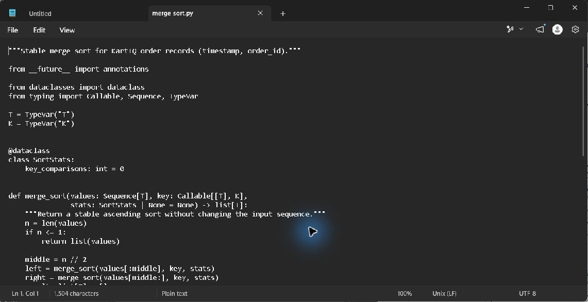
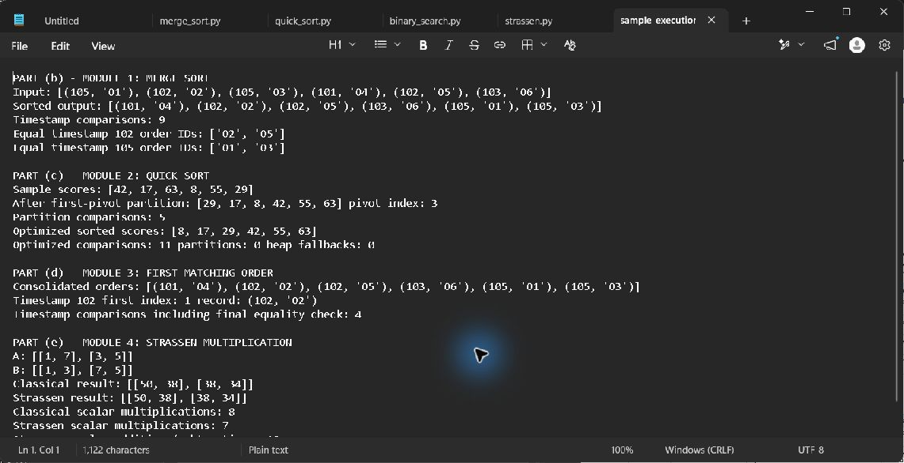

# Module 1: Nightly order consolidation

## Requirement and design

Orders must be sorted by timestamp for the audit report. Orders with equal timestamps must retain gateway arrival order. Merge Sort meets the stability requirement when the merge chooses the left-half record on equal timestamps.

## Sample result

Input: `(105,O1), (102,O2), (105,O3), (101,O4), (102,O5), (103,O6)`  
Output: `(101,O4), (102,O2), (102,O5), (103,O6), (105,O1), (105,O3)`

The timestamp-102 records remain `O2, O5`; the timestamp-105 records remain `O1, O3`.

## Recurrence and production calculation

`T(n) = 2T(n/2) + Theta(n) = Theta(n log n)`. The split recursion uses `O(log n)` stack frames, and merge buffers require `O(n)` auxiliary space. For 10,000,000 records, `n log2(n)` is about 232.5 million comparisons as a scale estimate. Under the balanced split and worst-case merge recurrence, the comparison bound is `n ceil(log2 n) - 2^ceil(log2 n) + 1 = 223,222,785`.

For records that do not fit in memory, create sorted runs from sequential chunks and merge them in multiple passes. Retaining the original arrival sequence as a secondary key `(timestamp, arrival_index)` preserves stability across runs.

Pseudocode is in `../Pseudocode/merge_sort.md`; source is in `../Source_Code/merge_sort.py`. Run the shared harness from the case-study root. The final report includes the merge-by-merge trace and output evidence.

