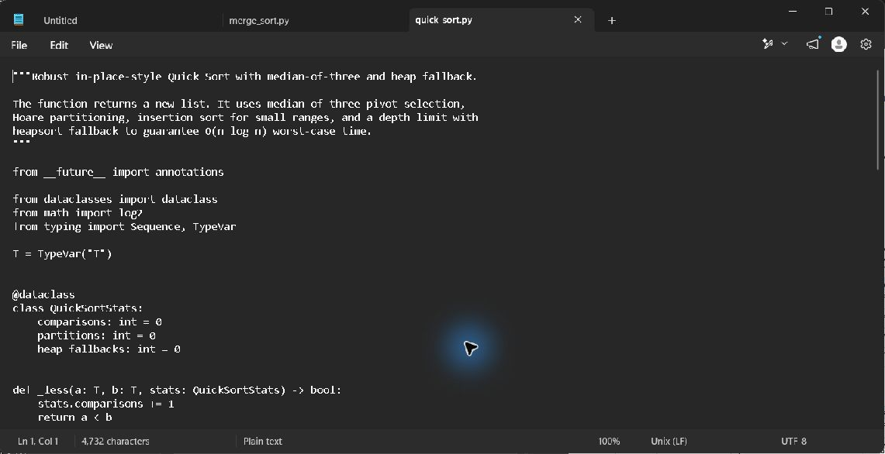
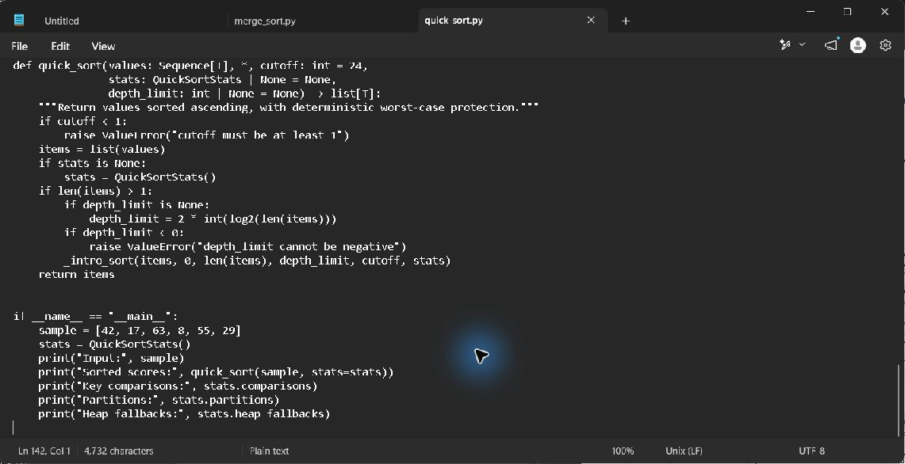
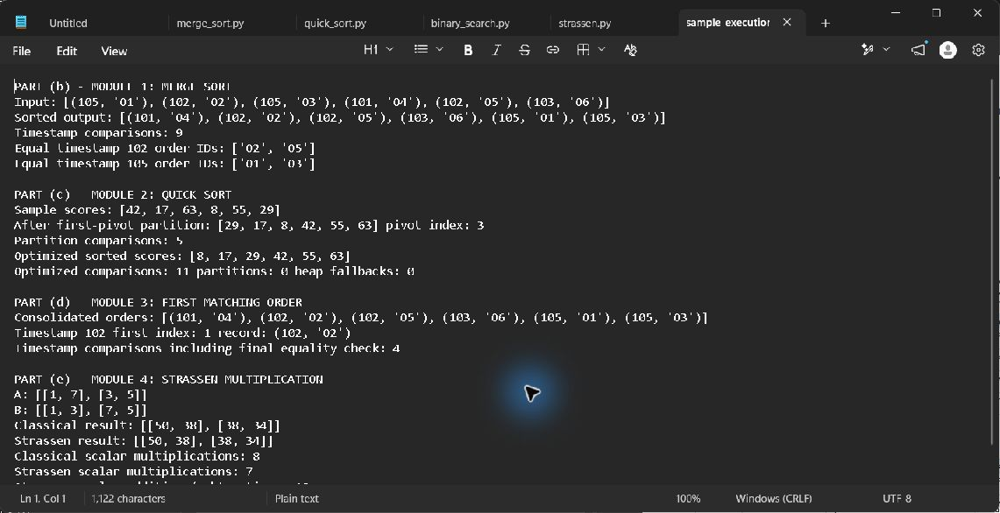

# Module 2: Live seller leaderboard

## Requirement and issue

Scores are re-sorted frequently and are almost sorted between refreshes. First-element-pivot Quick Sort partitions sorted input into sizes `0` and `n-1`, causing quadratic work. The executable baseline reproduces this behavior; the production algorithm uses median-of-three selection, Hoare partitioning, insertion sort for short ranges, and a heapsort fallback at a depth limit.

## Sample partition

For `[42, 17, 63, 8, 55, 29]`, the first pivot is `42`. The scan compares the five remaining values and places values below 42 to its left, yielding `[29, 17, 8, 42, 55, 63]`; the pivot ends at index 3. The complete sorted output is `[8, 17, 29, 42, 55, 63]`.

## Recurrences and production estimate

Balanced Quick Sort has `T(n)=2T(n/2)+(n-1)=Theta(n log n)`. First-pivot worst case has `T(n)=T(n-1)+(n-1)=Theta(n^2)`. For 100,000 already ordered scores, the first-pivot count is exactly `100,000 * 99,999 / 2 = 4,999,950,000`; a nearly ordered sequence can remain close to this depending on the disturbed positions. A balanced partition scale estimate is about `n log2 n = 1.66 million` comparisons; the included near-sorted benchmark measures the actual guarded implementation on a reproducible input.

The depth limit plus heapsort fallback makes the optimized implementation `O(n log n)` in the worst case. Hoare partitioning distributes repeated scores across both sides. Internal stack use is `O(log n)`; returning a fresh sorted list uses `O(n)` total additional storage.

Pseudocode is in `../Pseudocode/quick_sort.md`. Source files are `../Source_Code/quick_sort_baseline.py` and `../Source_Code/quick_sort.py`.

