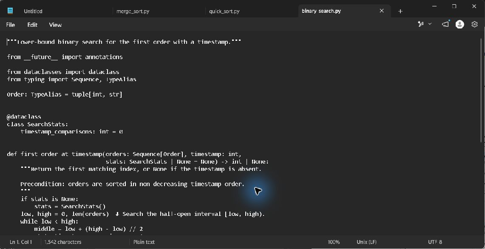
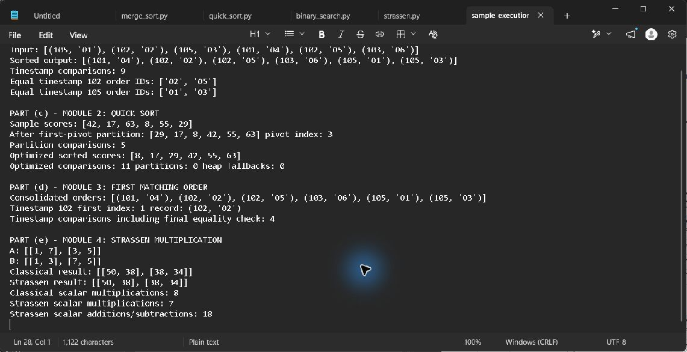

# Module 3: First matching order lookup

## Requirement and precondition

Support staff search the timestamp-sorted output from Module 1. Binary Search depends on this ordering; sorting once and reusing the consolidated list makes each lookup logarithmic. Duplicate timestamps require lower-bound search rather than returning whichever midpoint happens to match.

## Sample trace

Search timestamp `102` in `[101,102,102,103,105,105]` using a half-open range: midpoint index 3 has timestamp 103, so move the high bound to 3; midpoint 1 equals 102, so keep the left half by moving high to 1; midpoint 0 is 101, so move low to 1. The insertion point is index 1, which is the first 102 record `(102,O2)`.

## Recurrence and production calculation

`T(n)=T(ceil(n/2))+1=Theta(log n)` with `O(1)` auxiliary space. For 10,000,000 records, the lower-bound loop needs at most `ceil(log2(10,000,001))=24` timestamp probes. If a match may be present, one final equality comparison verifies it, so the implementation counts at most 25 timestamp comparisons including that final check. An absent key that falls after the final item uses at most 24 key probes.

Pseudocode is in `../Pseudocode/binary_search.md`; source is `../Source_Code/binary_search.py`.

