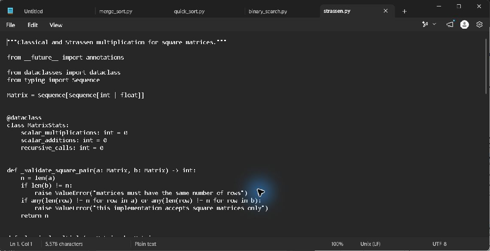
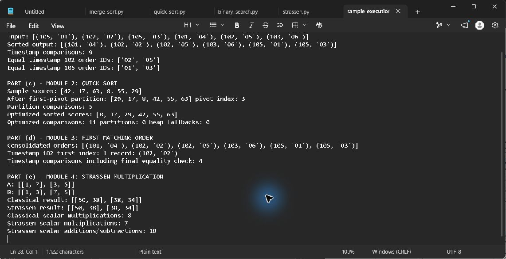

# Module 4: Recommendation score multiplication

## Requirement and sample verification

Compute `C = A x B` for a segment-feature matrix and a feature-product matrix. For the supplied matrices, both conventional multiplication and Strassen return `[[50, 38], [38, 34]]`. The forced 2-by-2 Strassen execution uses seven scalar multiplications instead of eight and also performs 18 scalar additions/subtractions.

## Recurrence and 1,024-square workload

`T(n)=7T(n/2)+Theta(n^2)=Theta(n^log2(7))`, where `log2(7) ~= 2.807`. Conventional multiplication uses `n^3` scalar multiplications. At `n=1,024`, that is `1,073,741,824`. Pure Strassen reaches `7^10=282,475,249`, about 73.7% fewer scalar multiplications. A hybrid with a conventional cutoff of 64 uses `7^4 * 64^3 = 629,407,744` multiplications, about 41.4% fewer than classical multiplication.

The executable accepts non-power-of-two square dimensions by padding and cropping. Recursive quadrants and temporary products require `O(n^2)` peak auxiliary storage in this implementation. Matrix additions, copies, allocation, cache behavior, and floating-point error can erase the theoretical multiplication savings; choose the cutoff by measuring on the production hardware and matrix type.

Pseudocode is in `../Pseudocode/strassen.md`; implementation and classical baseline are in `../Source_Code/strassen.py`.

