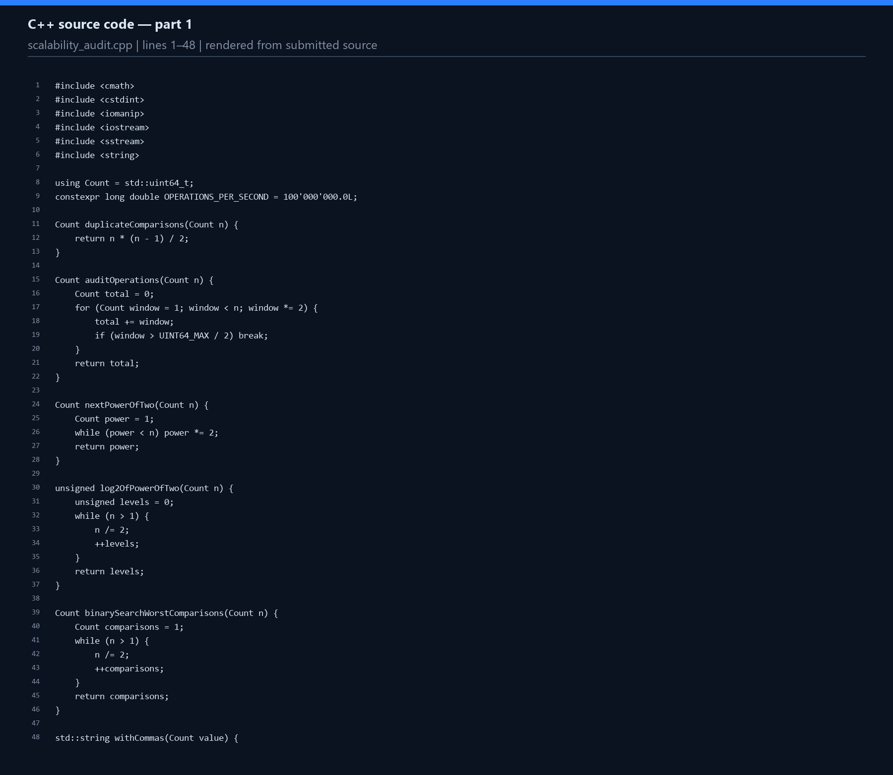
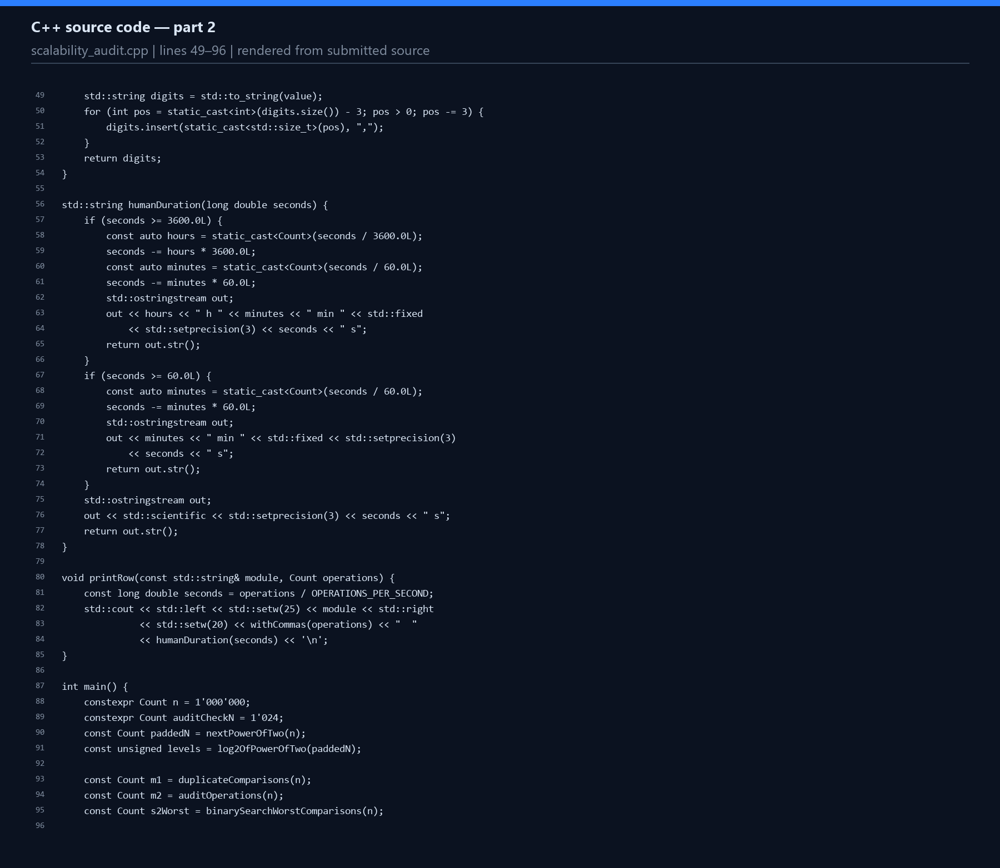
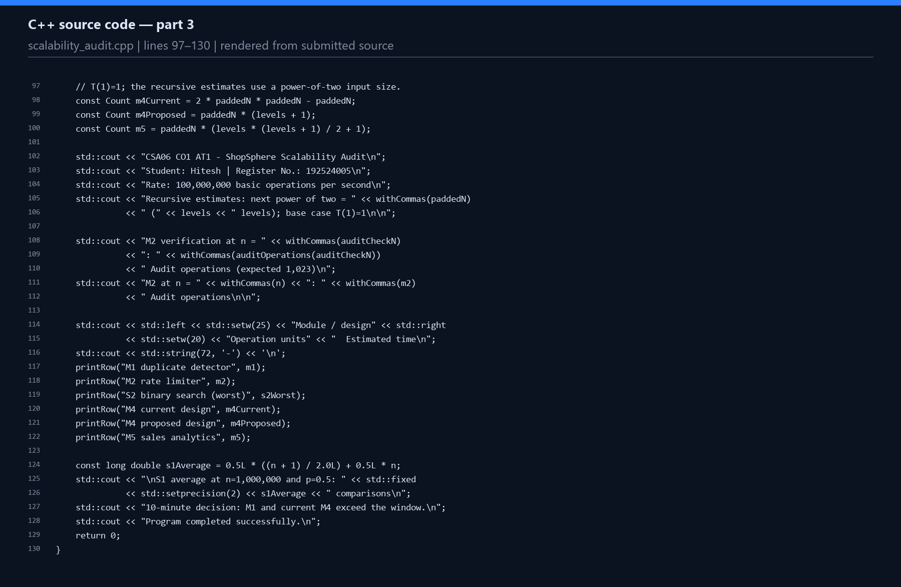
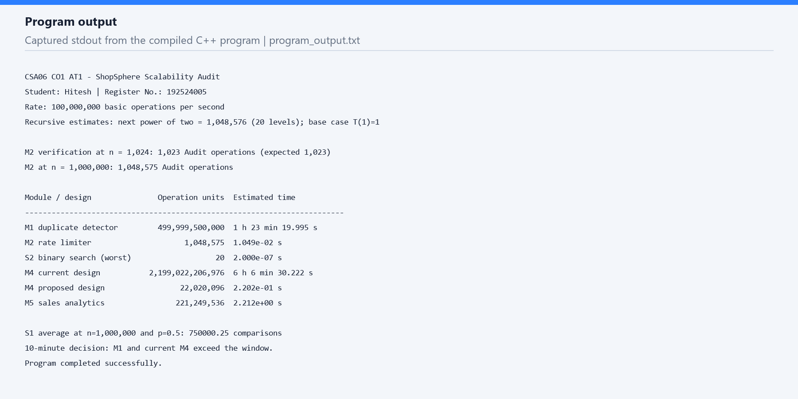
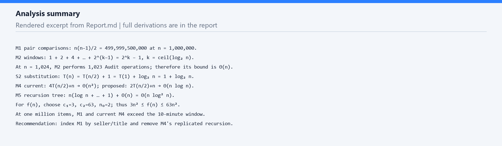
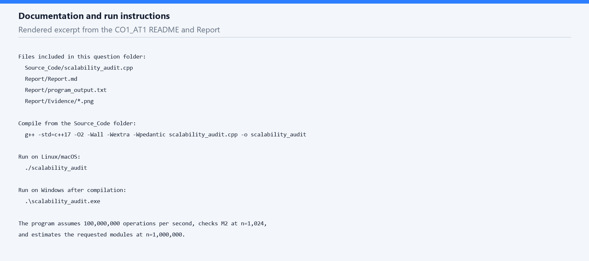

# ShopSphere Scalability Audit

## CSA06 CO1 Assessment Tool 1

**Student:** Hitesh  
**Register number:** 192524005  
**Course:** CSA06 – Design and Analysis of Algorithms  
**Question:** IT application-based problem solving

## Objective

This report examines the five ShopSphere back-end modules as the catalogue grows from 100,000 to 1,000,000 products. It identifies each dominant operation, derives the requested counts and recurrences, and compares estimated processing times with the 10-minute nightly window. The main conclusion is that the duplicate detector and the current recommendation design need changes before the catalogue reaches one million products.

## Assumptions and method

- One basic operation per second-rate unit is assumed to run at 100,000,000 operations per second, as given in the question. Estimated seconds equal operation units divided by 100,000,000.
- The exact M1 and M2 counts use the input n = 1,000,000.
- For recurrence estimates, n is rounded up to the next power of two, 1,048,576 = 2²⁰. This makes the recursive levels integral and gives a slightly conservative estimate for one million items.
- For the recurrence estimates, the base count is T(1) = 1. For M4 and M5, the count includes the work at internal nodes and the one-unit base cases.
- These are mathematical estimates under the stated rate, not a benchmark of processing one million real products. The C++ program calculates the estimates; its own runtime is not the platform runtime.

## (a) Understand the problem

The input size n is the number of products or records being processed. A basic operation is the repeated unit whose count gives the dominant growth rate.

| Module | Input and dominant operation | Where it occurs and growth |
|---|---|---|
| M1 Duplicate-Listing Detector | n products; compare a pair's title and seller | The equality check occurs for every unordered pair. There are n(n − 1)/2 comparisons, so the count grows as Θ(n²). |
| M2 API Rate Limiter | n requests; execute `Audit(Request[j])` | It runs for windows of sizes 1, 2, 4, … below n. The geometric sum is less than 2n, so it grows as Θ(n), not Θ(n log n). |
| M3 S1 Product Search | n unsorted products; compare the search key with a product | A sequential scan may inspect every product, so the worst-case count grows as Θ(n). |
| M3 S2 Product Search | n sorted products; compare with the middle key | Each comparison discards half the remaining index. The count grows as Θ(log n). |
| M4 Recommendation Engine | n customer-product records; combine partial results | The current design has four recursive parts of size n/2 and linear combine work, giving Θ(n²). Removing replication gives two parts and Θ(n log n). |
| M5 Sales Analytics Engine | n sales records; sort at every recursive level | The recurrence adds n log n work per level, giving Θ(n log² n). The separate report-generator function is analyzed in part (f). |

## (b) Iterative modules

### M1 exact comparisons

For each outer-loop index i, the inner loop compares product i with the n − i − 1 later products:

```text
C_M1(n) = Σ(i=0 to n−2) (n−i−1)
        = (n−1) + (n−2) + … + 2 + 1
        = n(n−1)/2
```

At n = 1,000,000:

```text
C_M1 = 1,000,000 × 999,999 / 2
     = 499,999,500,000 comparisons
```

The time complexity is Θ(n²). The loops use Θ(1) auxiliary space, excluding the product catalogue itself.

### M2 exact Audit count

The outer-loop values are powers of two smaller than n. Let k = ⌈log₂ n⌉. The audited window sizes are 1, 2, 4, …, 2^(k−1):

```text
C_M2(n) = 1 + 2 + 4 + … + 2^(k−1)
        = 2^k − 1
        = 2^⌈log₂ n⌉ − 1
```

For n = 1,024, k = 10, so the sizes are 1 through 512 and the count is 2¹⁰ − 1 = **1,023**. The program prints this verification. The claim Θ(n log n) is incorrect: the sum is less than 2n and at least n − 1, so the tight bound is **Θ(n)**. The routine uses Θ(1) auxiliary space.

For n = 1,000,000, k = 20 and the count is 2²⁰ − 1 = **1,048,575**.

## (c) Solve S2 by backward substitution

The recurrence is T(n) = T(n/2) + 1, with T(1) = 1. Assume n = 2^k for the exact derivation:

```text
T(n)       = T(n/2) + 1
           = T(n/4) + 2
           = T(n/8) + 3
           = …
           = T(n/2^k) + k
```

Stop when n/2^k = 1. Then k = log₂ n, so:

```text
T(n) = T(1) + log₂ n = 1 + log₂ n
```

Thus S2 takes Θ(log n) time. An iterative binary search uses Θ(1) auxiliary space. A recursive binary search uses Θ(log n) call-stack space. For an arbitrary integer-sized index, the worst number of key comparisons is ⌊log₂ n⌋ + 1; at n = 1,000,000, that is 20 comparisons. The recurrence's exact closed form above assumes a power-of-two input.

## (d) Master Theorem and recursion tree

### M4 current design

For T(n) = 4T(n/2) + n:

| Quantity | Value |
|---|---|
| a | 4 |
| b | 2 |
| f(n) | n |
| n^(log_b a) | n^(log₂4) = n² |
| Comparison | f(n) = O(n^(2−1)); it is polynomially smaller |
| Case and result | Master Theorem Case 1; Θ(n²) |

For n = 2^k, level i has 4^i subproblems of size n/2^i. Each subproblem contributes n/2^i combine operations, so the whole level costs 4^i(n/2^i) = n·2^i. The internal levels cost:

```text
Σ(i=0 to k−1) n·2^i = n(2^k − 1) = n(n − 1)
```

There are 4^k = n² leaves, each with one base operation. Thus T(n) = n(n − 1) + n² = **2n² − n**. At n = 1,048,576 this gives **2,199,022,206,976** operation units.

Doubling n multiplies this dominant cost by about 4. The estimate at the padded size 1,048,576 is 2n² − n = 2,199,022,206,976 operation units when T(1) = 1.

### M4 proposed design

For T(n) = 2T(n/2) + n:

| Quantity | Value |
|---|---|
| a | 2 |
| b | 2 |
| f(n) | n |
| n^(log_b a) | n^(log₂2) = n |
| Comparison | f(n) = Θ(n^(log_b a)) |
| Case and result | Master Theorem Case 2; Θ(n log n) |

At level i there are 2^i subproblems of size n/2^i, so the total combine work at that level is n. There are k = log₂n internal levels, for nk combine operations, and n leaves with one base operation each. Therefore T(n) = nk + n = **n(log₂n + 1)**. At n = 1,048,576 this gives **22,020,096** operation units.

When n doubles, the dominant work grows by roughly a factor of 2, with a small logarithmic increase: T(2n)/T(n) ≈ 2(log₂n + 1)/log₂n. This is a substantial improvement over the current quadratic design.

### M5 sales analytics

For T(n) = 2T(n/2) + n log₂n, a = 2, b = 2 and n^(log_b a) = n. The added work is n log n, which has the same polynomial exponent and one extra logarithmic factor. Under the extended Master Theorem (or by a recursion tree),

```text
T(n) = Θ(n log² n)
```

At recursion-tree level i, the total local work is n log₂(n/2^i) = n(k − i). Summing these values over the k = log₂n internal levels gives:

```text
Σ(i=0 to k−1) n(k − i) = n(1 + 2 + … + k)
                       = nk(k + 1)/2
```

The n leaves contribute another n base operations. Thus T(n) = n(k(k + 1)/2 + 1), which is Θ(n log²n). At n = 1,048,576 (k = 20), the estimate is **221,249,536** operation units.

## (e) Best, average and worst cases

### S1 sequential search

- **Best:** the product is first in the catalogue: 1 comparison.
- **Average when present:** if each position is equally likely, (1 + 2 + … + n)/n = (n + 1)/2 comparisons.
- **Worst:** the product is last or absent: n comparisons.

Let p be the probability that the product exists. If it exists, use the average successful count (n + 1)/2; if it does not, the scan checks all n products:

```text
E[C_S1] = p(n + 1)/2 + (1 − p)n
        = n(1 − p/2) + p/2
```

For n = 1,000,000 and p = 0.5:

```text
E[C_S1] = 0.5 × 500,000.5 + 0.5 × 1,000,000
        = 750,000.25 comparisons
```

### S2 binary search

- **Best:** the target equals the first middle key: 1 comparison.
- **Average:** Θ(log n) comparisons for a balanced sorted index; the exact mean depends on the midpoint convention and catalogue size.
- **Worst:** the target is at the deepest search position or absent: ⌊log₂n⌋ + 1 comparisons. At n = 1,000,000, this is 20.

## (f) Prove the report-generator bound

The function is f(n) = 3n² + 10n log₂n + 50. We use the definition of Θ(n²): find positive constants c₁, c₂ and n₀ such that c₁n² ≤ f(n) ≤ c₂n² for every n ≥ n₀.

For n ≥ 2, log₂n ≤ n, and 1 ≤ n². Therefore:

```text
3n² ≤ f(n)
f(n) = 3n² + 10n log₂n + 50
     ≤ 3n² + 10n² + 50n²
     = 63n²
```

Choose **c₁ = 3, c₂ = 63 and n₀ = 2**. Both inequalities hold for all n ≥ 2, so f(n) = Θ(n²).

To show f(n) is not O(n), divide by n:

```text
f(n)/n = 3n + 10 log₂n + 50/n ≥ 3n
```

The right-hand side grows without bound. No fixed constant c can satisfy f(n) ≤ cn for all sufficiently large n. Hence f(n) is **not O(n)**.

## (g) One-million-item estimates and decision

The times below use 100,000,000 operations/second. For recursive rows, n is padded to 1,048,576 and T(1) = 1. The operation units in the M4 and M5 rows follow the recurrences, including leaf base cases.

| Module/design | Estimated operation units | Estimated time | Within 10 minutes? |
|---|---:|---:|---|
| M1 duplicate detector | 499,999,500,000 | 1 h 23 min 19.995 s | No |
| M2 rate limiter | 1,048,575 | 0.0105 s | Yes |
| S2 binary search, worst case | 20 | 0.0000002 s | Yes |
| M4 current design | 2,199,022,206,976 | 6 h 6 min 30.222 s | No |
| M4 proposed design | 22,020,096 | 0.2202 s | Yes |
| M5 sales analytics | 221,249,536 | 2.2125 s | Yes |

M1 and the current M4 design exceed the 10-minute window and should be redesigned. For M1, index products by a composite key such as `(seller, normalized title)` so duplicate checks use a hash table or database index; expected processing becomes Θ(n), with Θ(n) additional storage. For M4, remove replicated recursive work and use the proposed two-way split with linear merging, reducing the recurrence to Θ(n log n). M2 and S2 fit easily. M5 also fits under the stated model; it can be monitored as data grows, and avoiding repeated sorting at every recursive level could reduce its cost to Θ(n log n).

The separate function f(n) from part (f) is quadratic, but the question does not provide a constant factor linking that profile to the M5 recurrence. It is therefore proved asymptotically in part (f), not added as a separate row to the M5 estimate.

## Program and verification

The C++17 program in `../Source_Code/scalability_audit.cpp` calculates the M1 count, M2 geometric sum, binary-search comparison bound, and the padded recursive estimates. It also checks the M2 count at n = 1,024. It was compiled with `g++ -std=c++17 -O2 -Wall -Wextra -Wpedantic` using LLVM-MinGW (Clang 23.1.1), then executed successfully. The compiler details are in `compile_log.txt`; the captured output is in `program_output.txt`.

### Source code screenshots

These images are rendered directly from the submitted source file, with line numbers, for readability.







### Program output screenshot

This image is a readable rendering of the output captured from the executed program.



### Analysis and documentation screenshots

The report itself contains the full derivations and run instructions. These snapshots highlight the analysis and documentation sections.





## Code of conduct

The question paper requires the student to certify the submission and sign it. Review the course policy and complete this section personally. Do not sign the declaration unless it is accurate for your work and the assistance used.

Student name: Hitesh  
Register number: 192524005  
Student signature: ______________________________  
Date: __________________
