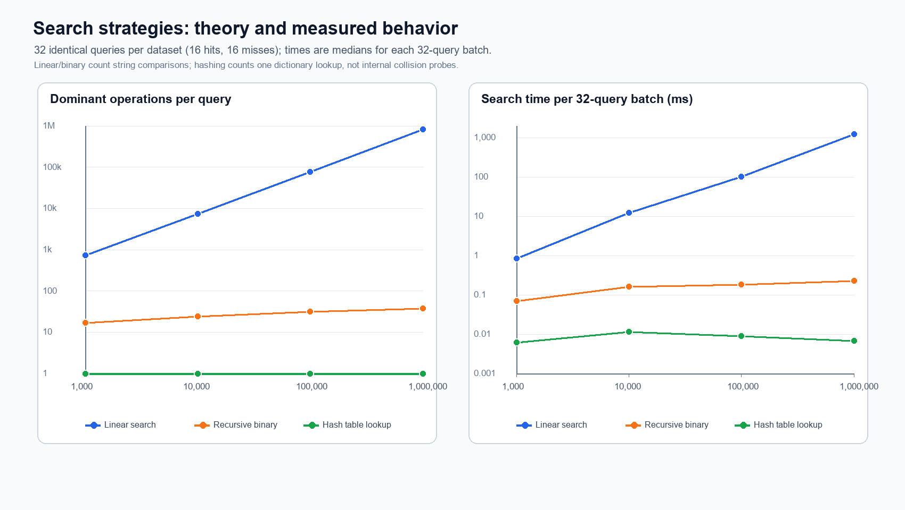
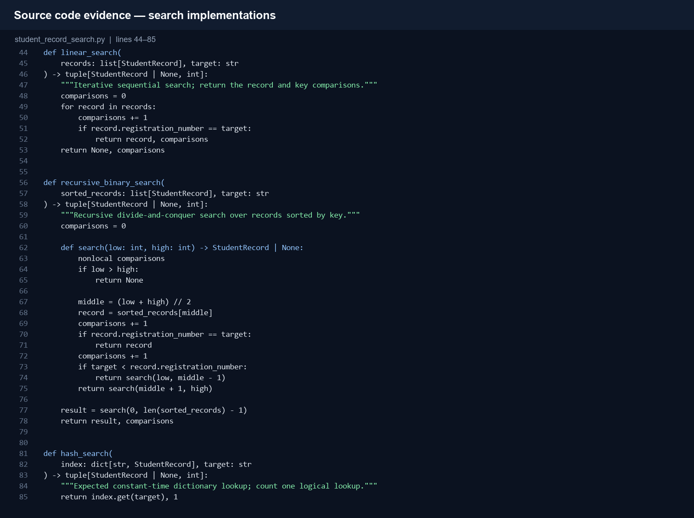
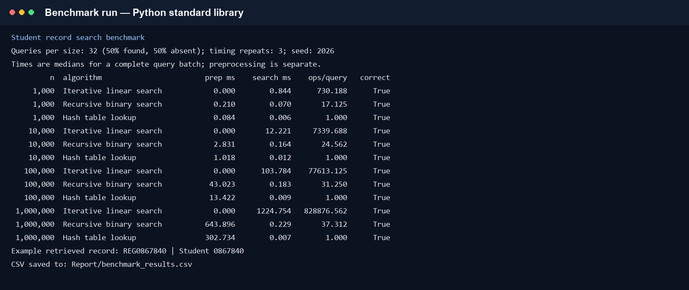

# Assignment 1 — CO1

## Design, Analyse and Validate an Efficient Search Strategy for a Large-Scale Student Record System

**Course:** CSA06 — Design and Analysis of Algorithms  
**Student:** Hitesh C  
**Course outcome:** Determine algorithm efficiency using asymptotic notation and mathematical techniques, including recurrence analysis.  
**Total marks:** 50

## Abstract

This report compares iterative linear search, recursive binary search, and a hash-table index for retrieving a student record by its unique registration number. The analysis includes preprocessing, mathematical operation counts, best/average/worst cases, asymptotic growth, a recurrence solution, and a reproducible benchmark using 1,000 through 1,000,000 synthetic records. For the changed workload of 50,000 lookups per hour and daily additions, the recommended design is a hash index maintained as records are added.

## 1. Problem model and assumptions

- The registration number is unique and the search is for an exact key.
- The linear-search input is in unsorted order. Binary search first sorts a copy of the records by registration number.
- The hash-table index maps a registration number to its complete synthetic record.
- The benchmark generates shuffled, unique registration numbers. A record contains its registration number and a synthetic student ID.
- Dataset creation is common input preparation and is outside the timed preprocessing. Sorting and hash-index construction are timed separately and reported.
- Each benchmark size uses 32 deterministic queries: 16 present keys selected from the data and 16 absent keys. The same query set is passed to all three algorithms. Each timing is the median of three complete query batches.
- Linear search counts key equality comparisons. Binary search counts its actual string comparisons: equality, followed by ordering when unequal. For hashing, the counter records one dictionary `get` per query; Python does not expose its internal hash and collision probes.

## 2. Task 1 — Algorithm design

### Approach A: iterative linear search

**Strategy:** sequential search. Inspect records in their existing order and stop at the first matching registration number. No preprocessing is required. It is useful as a simple baseline and works even when the data is unsorted.

```text
LINEAR-SEARCH(records, target)
    for each record in records
        if record.registration_number = target
            return record
    return NOT_FOUND
```

### Approach B: recursive binary search

**Strategy:** divide and conquer. Sort records by registration number once, compare the target with the middle record, and recursively continue in only the half that can contain the target. The sorted copy is required preprocessing. This approach is selected to investigate logarithmic search after ordering the data.

```text
RECURSIVE-BINARY-SEARCH(sorted_records, target, low, high)
    if low > high
        return NOT_FOUND
    middle = floor((low + high) / 2)
    if sorted_records[middle].registration_number = target
        return sorted_records[middle]
    if target < sorted_records[middle].registration_number
        return RECURSIVE-BINARY-SEARCH(sorted_records, target, low, middle - 1)
    return RECURSIVE-BINARY-SEARCH(sorted_records, target, middle + 1, high)
```

### Approach C: hash-table lookup

**Strategy:** hashing/indexing. Build a map from each registration number to its record, then use the key to retrieve the record directly. Index construction is preprocessing. It is selected because the application performs many exact-key lookups and the records change infrequently.

```text
BUILD-HASH-INDEX(records)
    index = empty hash table
    for each record in records
        index[record.registration_number] = record
    return index

HASH-LOOKUP(index, target)
    return index.get(target, NOT_FOUND)
```

The three strategies are different: sequential scanning, divide-and-conquer on ordered data, and key indexing by hashing. The implementation is in [`student_record_search.py`](../../Task_8_Implementation_Testing/Source_Code/student_record_search.py).

## 3. Task 2 — Basic operation

| Algorithm | Basic operation | Where it occurs and why it dominates |
|---|---|---|
| Linear search | Compare a record's registration number with the target | Once for each inspected record. The count grows with how far the target is in the list, or to all `n` records if absent. |
| Recursive binary search | Compare the target key with the middle record's key | At each recursive level, the comparison determines whether the target was found or which half remains. The remaining input is approximately halved at each call. |
| Hash-table lookup | Hash-table lookup (`dict.get`) | One logical lookup is issued per request. Its expected cost is constant under a well-distributed hash; internal probes are implementation details and are not exposed by Python's dictionary API. |

The comparison counts for linear and binary search are key comparisons. Hash lookup counts are reported separately as logical dictionary lookups, not as if they were string comparisons.

## 4. Task 3 — Mathematical time-complexity derivations

Let `n` be the number of records and `q` the number of search requests.

### Linear search

If the target is at one-based position `k`, the search performs `C(n) = k` equality comparisons. If the target is absent, it performs `C(n) = n`. A successful target uniformly distributed among the records has average count:

```text
E[C | present] = (1 + 2 + ... + n) / n
              = n(n + 1) / (2n)
              = (n + 1) / 2
```

For a 50% present / 50% absent workload, the expected count is:

```text
E[C] = 0.5 × (n + 1)/2 + 0.5 × n = (3n + 1)/4
```

There is no algorithm-specific preprocessing. For `q` requests, the expected search work under this mix is `q(3n + 1)/4`, and the worst case is `qn`.

### Recursive binary search

At each call, binary search inspects the middle record and recurses into at most one subproblem of size approximately `n/2`. A nonmatching midpoint uses an equality comparison and an ordering comparison; this is still constant work per call. The recurrence is:

```text
T(n) = T(floor(n / 2)) + c,  n > 1
T(0) = c0; T(1) = c1
```

The recursive search is `Θ(log n)`. Because the input must be sorted first, sorting costs `Θ(n log n)` time and `Θ(n)` additional space for the sorted list. For `q` requests against that sorted list, total work is `Θ(n log n + q log n)`. If the sorted index is retained across requests, the sorting cost is paid once per rebuild, not once per query.

### Hash-table lookup

Building the index inserts each of the `n` records once. With expected constant-time insertion, the expected build cost is `Θ(n)`. Each exact-key request has expected `Θ(1)` lookup cost, so the expected total for building the index and serving `q` requests is:

```text
T(n, q) = Θ(n) + q × Θ(1) = Θ(n + q)   (expected)
```

The index uses `Θ(n)` additional space. If keys collide pathologically, lookup can degrade to `Θ(n)` in the worst case; the expected result relies on a suitable hash distribution and implementation behavior.

## 5. Task 4 — Best, average, and worst cases

| Algorithm | Best case | Average case under stated assumptions | Worst case |
|---|---|---|---|
| Linear | Target is first: 1 comparison, `Θ(1)` | Successful uniform target: `(n+1)/2`; mixed present/absent: `(3n+1)/4`; both `Θ(n)` | Target last or absent: `n`, `Θ(n)` |
| Recursive binary | Target is at the first middle: 1 equality comparison, `Θ(1)` | Search follows about half the remaining range per level: `Θ(log n)` | Target absent or reached at the deepest level: at most `floor(log2 n)+1` inspected midpoints; at most twice that many primitive key comparisons, `Θ(log n)` |
| Hash table | Key resolves immediately with no collision: expected `Θ(1)` | Expected `Θ(1)` lookup with a well-distributed hash | Severe collisions can require `Θ(n)` work |

Linear search varies because it stops as soon as it finds the key. Binary search reduces the candidate range at every call, so even a miss follows only a logarithmic number of levels. Hashing usually addresses the bucket directly, but collisions explain its linear worst case.

## 6. Task 5 — Asymptotic comparison

| Algorithm phase | Best / expected growth | Worst growth | Effect as the dataset grows |
|---|---|---|---|
| Linear lookup | Best `Ω(1)`; expected `Θ(n)` for general positions | `O(n)` | Increasing records by 10× can increase a full scan by about 10×. |
| Binary lookup after sorting | Best `Ω(1)`; average `Θ(log n)` | `O(log n)` | A 10× increase adds only about `log2(10) ≈ 3.32` search levels. Sorting remains `Θ(n log n)`. |
| Hash lookup | Expected `Θ(1)` per lookup; expected build `Θ(n)` | `O(n)` per lookup in a collision-heavy worst case | Expected lookup work stays nearly flat as records grow; the index and its build work grow linearly. |

The following values show the expected comparison count for the 50/50 linear-search workload, an upper bound on primitive binary key comparisons, and one logical hash lookup per request:

| `n` | Linear expected comparisons/query `(3n+1)/4` | Binary upper bound `2(floor(log2 n)+1)` | Hash logical lookups/query (expected) |
|---:|---:|---:|---:|
| 1,000 | 750 | 20 | 1 |
| 10,000 | 7,500 | 28 | 1 |
| 100,000 | 75,000 | 34 | 1 |
| 1,000,000 | 750,000 | 40 | 1 |

## 7. Task 6 — Recurrence relation

For the recursive binary search, the original problem contains `n` sorted records. One recursive call is made after each unsuccessful midpoint check, and that call receives at most `floor(n/2)` records. The equality and ordering checks plus index arithmetic do constant work outside the recursive call. If `T(n)` counts time, the recurrence is:

```text
T(n) = T(floor(n / 2)) + c,  n > 1
T(1) = c1
T(0) = c0
```

The `n=0` base case represents the empty range reached after an unsuccessful search; `n=1` is the final possible record inspection. The recurrence follows the implementation's halving behavior rather than being assumed independently.

## 8. Task 7 — Recurrence solution

Using iteration and ignoring floor effects for the growth-rate derivation:

```text
T(n) = T(n/2) + c
     = T(n/4) + 2c
     = T(n/8) + 3c
     = T(n/2^k) + kc
```

The recursion reaches a base case when `n/2^k ≤ 1`, so `k ≈ log2 n`. Therefore `T(n) = Θ(log n)`. The Master Theorem gives the same result: `a=1`, `b=2`, and `f(n)=Θ(1)`; since `n^(log_b a)=1`, the equal-growth case yields `Θ(log n)`. The method applies because there is one half-sized recursive subproblem and constant work at each level.

## 9. Task 8 — Implementation and test procedure

The implementation uses Python 3.10+ and the standard library. Registration numbers are unique and shuffled with a fixed seed. For each size, it:

1. Builds the same synthetic record list for all strategies.
2. Times sorting a copy for binary search and building the dictionary for hashing.
3. Creates 32 identical queries (16 existing and 16 missing) and runs them against all three methods.
4. Repeats each search batch three times and reports the median time.
5. Checks returned records against the expected hit/miss result and separately checks keys from the first and last positions of the original list, plus an absent key.

Dataset creation and query generation are excluded from the timing. Preprocessing time is shown separately. The CSV preserves all measurements and the random seed.

## 10. Task 9 — Experimental performance

Times below are milliseconds for a complete 32-query batch. Operation counts are mean dominant operations per request; for hashing, this means one dictionary lookup, not internal collision probes. The measured preprocessing columns are the sort time and the hash-index build time.

| Records | Linear search ms / operations per query | Binary sort ms / search ms / comparisons per query | Hash build ms / search ms / lookups per query |
|---:|---:|---:|---:|
| 1,000 | 0.844 / 730.188 | 0.210 / 0.070 / 17.125 | 0.084 / 0.006 / 1 |
| 10,000 | 12.221 / 7,339.688 | 2.831 / 0.164 / 24.562 | 1.018 / 0.012 / 1 |
| 100,000 | 103.784 / 77,613.125 | 43.023 / 0.183 / 31.250 | 13.422 / 0.009 / 1 |
| 1,000,000 | 1,224.754 / 828,876.562 | 643.896 / 0.229 / 37.312 | 302.734 / 0.007 / 1 |

All three methods returned correct results for all benchmark and edge-case queries.



**Source-code screenshot:**



**Benchmark output screenshot:**



The raw data is in [`benchmark_results.csv`](../Tables_and_Graphs/benchmark_results.csv), and the captured console output is in [`../Output_Screenshots/benchmark_output.txt`](../Output_Screenshots/benchmark_output.txt).

## 11. Task 10 — Theory versus experiment

The results follow the predicted growth. Linear-search operations increase from about 730 to about 828,877 per request as `n` increases from 1,000 to 1,000,000; this is linear growth. The observed 50/50 average is above the theoretical expectation of 750,000 at one million because only 16 successful positions were sampled in this run. Repeating with a different seed can change the sample average while preserving the linear trend.

Binary search grows slowly: the measured count rises from about 17 to 37 primitive key comparisons per request across three orders of magnitude. This remains within the logarithmic upper bound of 20 inspected midpoints, or at most 40 primitive key comparisons, at one million records. Search time also stays below 0.3 ms for all 32-query batches. The sort cost is visible separately and grows with `n`.

Hash lookup uses one logical dictionary lookup per request at every size, and its batch search time remains roughly flat in this run. At one million records, building the hash index took less time than sorting the records in this run; those constants depend on the machine and runtime. Both preprocessing steps are paid separately from each batch. Actual times vary with hardware, Python implementation, memory pressure, and runtime state, so operation counts and asymptotic trends are more portable than the milliseconds.

## 12. Task 11 — Final design recommendation

For exact registration-number queries, use a hash-based index as the primary lookup path. It has expected constant-time lookup after an expected linear-time build and was the fastest search in the measured batches. At one million records, the hash batch took 0.007 ms for 32 queries in this run, compared with 0.229 ms for recursive binary search and 1,224.754 ms for linear search.

The trade-offs are `Θ(n)` extra space and reliance on expected hash behavior. Binary search is a useful alternative when keys must remain ordered for range queries or ordered traversal; linear search needs no index but is unsuitable for frequent large-scale lookups. A production database should maintain an indexed registration-number column rather than loading a million Python objects into a single process.

## 13. Task 12 — Day-4 design challenge

### A. Impact analysis

The workload is now specified as 50,000 searches per hour against one million records, with additions only once per day. Search frequency is high relative to the update frequency: there are about 1.2 million lookups between daily update batches. This makes it worthwhile to build and retain an index. The original unsorted-data assumption still applies to linear search; binary search would require a sorted index and rebuild or insertion work when records change.

### B. Evaluate the original recommendation

The hash index remains suitable. In this benchmark, building it for one million records took 302.734 ms, and 32 lookups took 0.007 ms. These measurements are illustrative, not production guarantees. A dictionary lookup is expected `Θ(1)`, and the low daily update rate lets the system amortize index construction over many requests. Linear search would average about 750,000 key comparisons per request under a 50/50 hit/miss assumption; that is approximately 37.5 billion comparisons per hour. Binary search would require at most 40 primitive key comparisons per request (about 2 million per hour), plus sorting when rebuilding.

### C. Adaptation decision: retain and operationally modify

Retain the hash-based design and modify the update process: build the hash index at startup or during the daily batch, then insert each newly added record into the index. A single expected dictionary insertion is `Θ(1)`; a full rebuild is expected `Θ(n)`. Search remains expected `Θ(1)`. In a real database, use a persistent unique index on the registration-number column so the index survives restarts and supports concurrent requests.

### D. Evidence-based defence

The benchmark shows one logical hash lookup per query at all four sizes, while linear operations grow in proportion to the record count. Binary search also scales well, but needs sorted preprocessing and a logarithmic search. With 50,000 requests per hour and records added only once daily, keeping the hash index ready favors repeated lookups over minimizing occasional update work. The choice is therefore supported by the request/update ratio, expected complexity, and measured search results, while acknowledging the memory and worst-case collision trade-offs.

## 14. Limitations

This is a reproducible single-process microbenchmark using synthetic data, 32 queries per size, and one local Python environment. It does not measure database I/O, concurrent requests, production hash distributions, or memory consumption. The finite random query sample explains why measured averages differ from their exact expectations. Hash internal probes are not exposed, so the benchmark records the `dict.get` call as one logical lookup and does not claim one primitive operation internally.
